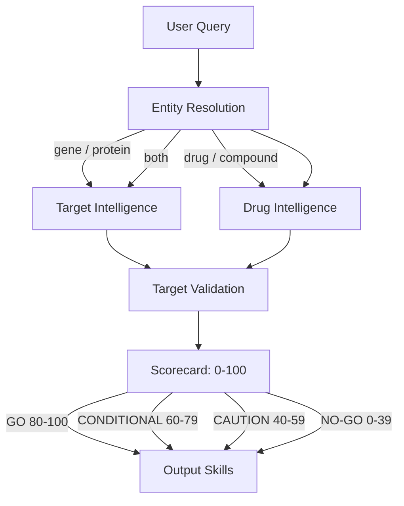

# Claude Scientific Writer Plugin

[](https://opensource.org/licenses/MIT)

A comprehensive Claude Code plugin with 30 specialized skills for end-to-end scientific research workflows — from biomedical target intelligence and literature analysis to accuracy verification, publication-ready documents, presentations, and figures.

## Background

Built on [K-Dense-AI/claude-scientific-writer](https://github.com/K-Dense-AI/claude-scientific-writer), this project has diverged significantly to focus on biomedical research intelligence. Key additions include a 4-skill bio-intelligence pipeline, integration with 2,400+ scientific database tools via ToolUniverse, a deterministic skill routing engine with 178 test cases, formal T1-T4 evidence grading across all research outputs, and a deterministic accuracy-verification audit pipeline (canonical Verdict enum + 70-cell severity matrix).

## Features

- **Bio-intelligence pipeline**: Entity resolution, target/drug dossiers, and quantitative 0-100 GO/NO-GO validation scoring
- **ToolUniverse integration**: 2,400+ scientific tools across 600+ databases with a data-feed pattern
- **Deterministic skill routing**: Keyword + regex engine with 136 canonical test cases at 100% pass rate
- **Evidence grading**: Every claim graded T1 (FDA label) through T4 (text-mined annotations)
- **Multi-mode deep research**: Literature review, systematic review, hypothesis generation, fact-checking (8 modes, 7 agents)
- **Tiered image generation**: Free Mermaid diagrams for simple workflows, AI generation (Gemini 3 Pro) for complex schematics
- **Publication-quality outputs**: Figures, slides, and posters meeting journal submission standards
- **Brand integration**: Consistent Oligon visual identity across all generated materials
- **MCP server ecosystem**: Open Targets, PubMed, Consensus, Scite, Zotero, and ToolUniverse

## Prerequisites

This plugin requires the **anthropic-agent-skills** marketplace plugin for document processing capabilities (DOCX, PDF, PPTX, XLSX).

```bash
/plugin marketplace add anthropics/agent-skills
/plugin install anthropic-agent-skills
```

For full functionality, configure these MCP servers. The core scientific writing skills (papers, slides, posters, figures) work without any MCP configuration. MCP servers extend the plugin with live database access for bio-intelligence and literature workflows.

| MCP Server | Purpose | Required For |
|------------|---------|--------------|
| Open Targets | Target-disease associations, genetic evidence | Bio-intelligence pipeline |
| PubMed | Biomedical literature search, full-text retrieval | Literature review, paper search |
| Consensus | Semantic search across 200M+ papers | Research workflows |
| Scite | Citation sentiment analysis (supporting/contrasting/mentioning) | Evidence reception, peer review, claim verification |
| ToolUniverse | 2,400+ scientific database tools | Bio-intelligence, data-enriched outputs |
| Zotero | Personal reference library management | Citation management |

MCP servers are configured in your Claude Code settings. See Claude Code documentation for `claude mcp add` syntax.

## Installation

```bash
# Add the marketplace source
/plugin marketplace add pickleton89/claude-scientific-writer-plugin

# Install the plugin
/plugin install claude-scientific-writer
```

Or test locally:
```bash
claude --plugin-dir /path/to/claude-scientific-writer-plugin
```

## Skills Included

### Visual Creation (5 skills)
| Skill | Description |
|-------|-------------|
| `visual-design` | Publication-quality figure standards, typography, accessibility |
| `plotting-libraries` | matplotlib, seaborn, ggplot2, Bioconductor patterns |
| `scientific-schematics` | Diagrams and illustrations (Mermaid + AI tiered generation) |
| `generate-image` | AI image generation via Gemini 3 Pro (OpenRouter) |
| `paperbanana` | Text-to-visual figures, graphical abstracts |

### Document Creation (7 skills)
| Skill | Description |
|-------|-------------|
| `scientific-writing` | Research papers (IMRaD), methodology, results in LaTeX/BibTeX |
| `executive-summary` | Concise summaries for decision-makers |
| `scientific-slides` | Research presentations |
| `research-posters` | Academic posters (LaTeX or PowerPoint) |
| `venue-templates` | Journal-specific formatting (Nature, Cell, NeurIPS, etc.) |
| `markdown-to-pdf` | Branded PDF generation |
| `document-skills` | Adapter routing to anthropic-agent-skills for DOCX, PDF, PPTX, XLSX |

### Research Workflow (5 skills)
| Skill | Description |
|-------|-------------|
| `deep-research` | Multi-mode research pipeline — literature review, systematic review, hypothesis generation, fact-checking (8 modes, 7 agents) |
| `citation-management` | BibTeX citations and bibliography management |
| `peer-review` | Manuscript review with database claim verification |
| `research-paper-summarizer` | Multi-format summaries with entity enrichment |
| `research-accuracy-verifier` | Audits AI-generated research documents for hallucinated citations, misattributed claims, fabricated quotes, and numerical errors. Canonical 10-value Verdict enum, 70-cell Verdict×DocumentType severity matrix, 5 hard predicates enforced by `validate_finding.py`, and Stages 5/7 promoted from prose to deterministic Python (`verify_exact_quote.py`, `reconcile_references.py`, `scan_acronyms.py`). |

### Analysis & Code (3 skills)
| Skill | Description |
|-------|-------------|
| `statistical-analysis` | Statistical methods, test selection, code generation (Python/R) |
| `reproducible-research` | FAIR standards, data deposition, environment management |
| `code-documentation` | Scientific code documentation (docstrings, READMEs) |

### Conversion (2 skills)
| Skill | Description |
|-------|-------------|
| `markitdown` | Convert documents (PDF, DOCX, images) to Markdown via Microsoft MarkItDown |
| `paper-2-web` | Paper2All pipeline — convert papers to web, video, and poster formats |

### Brand (1 skill)
| Skill | Description |
|-------|-------------|
| `oligon-brand` | Oligon organizational brand identity (colors, typography, adapters) |

### Bio-Intelligence (4 skills)
| Skill | Description |
|-------|-------------|
| `entity-resolution` | Resolve genes, drugs, diseases to canonical database IDs with collision detection |
| `target-intelligence` | 12-section target dossier (structure, function, expression, druggability) |
| `drug-intelligence` | 10-section drug dossier (chemistry, ADMET, safety, PGx, regulatory) |
| `target-validation` | Quantitative 0-100 GO/NO-GO scoring with T1-T4 evidence grading |

> **Skill count**: 27 unique skills (30 routing targets with `document-skills` expanding to 4 sub-skills). 6 skills are enhanced with ToolUniverse data feeds: scientific-schematics, plotting-libraries, peer-review, research-paper-summarizer, scientific-writing, and statistical-analysis.

## Bio-Intelligence Pipeline

The bio-intelligence skills form an integrated pipeline for biomedical target and drug assessment:



- **Entity Resolution** — Resolves ambiguous names (e.g., "ACE") to canonical IDs across Ensembl, UniProt, ChEMBL, PubChem, EFO, and MONDO. Includes collision detection with automatic negative filters.
- **Target Intelligence** — 12-section dossier: identifiers, structural biology (PDB, AlphaFold), pathways (Reactome, GO, STRING), interactions, expression (GTEx), variants (ClinVar, gnomAD), druggability, and safety.
- **Drug Intelligence** — 10-section dossier: identity, chemistry, mechanism (ChEMBL, pChEMBL >= 6.0), ADMET (ADMET-AI), clinical development (DailyMed), safety (FAERS), pharmacogenomics (PharmGKB), and regulatory status.
- **Target Validation** — Consumes upstream dossiers (never re-fetches) and scores 0-100 across 5 dimensions: Disease (30 pts), Druggability (25 pts), Safety (20 pts), Clinical (15 pts), Validation (10 pts).

> **Note on T1-T4 labels**: The plugin uses two T1-T4 scales. *Evidence grading* (T1=mechanistic through T4=text-mined) classifies the quality of individual claims. *Validation tiers* (GO/CONDITIONAL/CAUTION/NO-GO) classify overall target viability scores. See [`evidence_grading.md`](skills/shared/references/evidence_grading.md) for the evidence scale.

## ToolUniverse Integration

The plugin integrates with [ToolUniverse](https://github.com/tooluniverse) — a collection of 2,400+ scientific tools across 600+ databases — through a 5-phase integration completed in March 2026.

### Data-Feed Pattern

ToolUniverse has no server-side visualization. Instead, the plugin uses a **data-feed pattern**: ToolUniverse fetches raw data (expression profiles, PPI networks, enrichment results, variant frequencies), and existing skills render the output using matplotlib, Mermaid, or LaTeX.

### Three-Tier Preference

Every data lookup follows a 3-tier preference chain:

1. **Primary MCP** — Open Targets, PubMed, Consensus (existing, high-quality)
2. **ToolUniverse** — When primary is unavailable or a specialized capability is needed
3. **Fallback** — HGNC, UniProt, manual literature approaches

### Key Database Categories

| Category | Tools | Examples |
|----------|-------|---------|
| Enrichment | gProfiler, STRING, enrichr | Pathway enrichment, functional analysis |
| Expression | GTEx (12 tools), HPA (6+) | Tissue-specific expression profiles |
| Network | STRING, IntAct, NDEx, OmniPath | Protein-protein interaction networks |
| Structure | PDB, AlphaFold, GPCRdb | 3D structure data, domain architecture |
| Safety | FAERS (5-tool chain), ClinVar | Post-marketing adverse events, variant pathogenicity |
| Chemistry | ChEMBL, PubChem, ADMET-AI | Bioactivity, molecular properties, ADMET predictions |

Capability-to-tool mappings are maintained in [`skills/shared/tool-lookup.yaml`](skills/shared/tool-lookup.yaml) (v1.3.0, ~500 lines). Known API parameter quirks are documented in [`skills/shared/references/known_param_corrections.md`](skills/shared/references/known_param_corrections.md).

For the full integration architecture, see [`docs/TOOLUNIVERSE_INTEGRATION_DESIGN.md`](docs/TOOLUNIVERSE_INTEGRATION_DESIGN.md).

## Routing System

The skill router uses deterministic keyword + regex matching to select skills without LLM overhead for clear-cut tasks.

- **178 canonical test cases** across 30 routing targets, all passing (100%)
- **10 decision trees and 8 multi-skill workflows** covering single-skill, multi-skill, and bio-pipeline routing
- **Confidence scoring**: 0.7+ routes directly, 0.3-0.69 routes with clarification, <0.3 triggers disambiguation
- **Bio routing**: Biological research queries route through a disambiguation tree (entity-resolution → target-intelligence / drug-intelligence → target-validation)

Implementation: [`skills/skill-router/route.py`](skills/skill-router/route.py) + [`skills/skill-router/skill_triggers.yaml`](skills/skill-router/skill_triggers.yaml). Decision trees: [`skills/SKILL_ROUTER.md`](skills/SKILL_ROUTER.md).

## Configuration

### API Keys

| Feature | Environment Variable | Required For |
|---------|---------------------|--------------|
| OpenRouter API | `OPENROUTER_API_KEY` | AI image generation, document conversion with vision |
| Google AI | `GOOGLE_API_KEY` | PaperBanana text-to-visual generation |
| ToolUniverse | See `.env.template` | Bio-intelligence pipeline, data-enriched outputs |

Copy `.env.template` and fill in your keys:
```bash
cp .env.template .env
```

## Usage

Skills are automatically invoked based on your request. The routing system selects the appropriate skill(s).

### General scientific writing
```
"Write a methods section for my RNA-seq analysis"
→ Uses: scientific-writing

"Search for papers on CRISPR delivery mechanisms"
→ Uses: deep-research (quick mode)

"Create a poster for my conference presentation on single-cell proteomics"
→ Uses: research-posters + visual-design + oligon-brand

"Review this manuscript draft and check the statistics"
→ Uses: peer-review + statistical-analysis

"Generate a figure showing the experimental workflow"
→ Uses: scientific-schematics (Mermaid tier for simple, AI tier for complex)

"Summarize this paper and create slides for my lab meeting"
→ Uses: research-paper-summarizer + scientific-slides
```

### Bio-intelligence
```
"What do we know about EGFR as a drug target?"
→ Uses: entity-resolution → target-intelligence

"Generate a drug dossier for imatinib"
→ Uses: entity-resolution → drug-intelligence

"Should we pursue BRCA1 for our oncology program?"
→ Uses: entity-resolution → target-intelligence → drug-intelligence → target-validation

"Resolve ACE and tell me if it's a viable target for hypertension"
→ Uses: entity-resolution (collision detection) → target-intelligence → target-validation
```

### Data-enriched outputs
```
"Create a pathway diagram for MAPK signaling"
→ Uses: scientific-schematics + STRING/Reactome data via ToolUniverse

"Verify the claims in this manuscript against primary databases"
→ Uses: peer-review + OT/ClinVar/GWAS verification via ToolUniverse

"Plot BRCA2 tissue expression across GTEx"
→ Uses: plotting-libraries + GTEx data via ToolUniverse

"Generate hypotheses for targeting CDK4 in melanoma"
→ Uses: deep-research (hypothesis mode) + target biology context via ToolUniverse
```

## Commands

| Command | Description |
|---------|-------------|
| `/scientific-writer-init` | Initialize a scientific writing project |

## Architecture & Documentation

The plugin uses shared infrastructure across all skills:

| File | Purpose |
|------|---------|
| [`SKILL_ROUTER.md`](skills/SKILL_ROUTER.md) | 10 decision trees, 8 multi-skill workflows |
| [`tool-lookup.yaml`](skills/shared/tool-lookup.yaml) | Capability-to-tool mapping (~500 lines, 14 sections) |
| [`evidence_grading.md`](skills/shared/references/evidence_grading.md) | T1-T4 evidence classification framework |
| [`known_param_corrections.md`](skills/shared/references/known_param_corrections.md) | ToolUniverse API parameter quirks (50+ tools) |
| [`QUANTIFICATION_THRESHOLDS.md`](skills/QUANTIFICATION_THRESHOLDS.md) | 11 categories of numeric quality standards |
| [`TOOLUNIVERSE_INTEGRATION_DESIGN.md`](docs/TOOLUNIVERSE_INTEGRATION_DESIGN.md) | ToolUniverse integration architecture (5 phases) |
| [`CHANGELOG.md`](CHANGELOG.md) | Version history and updates |

## License

MIT
