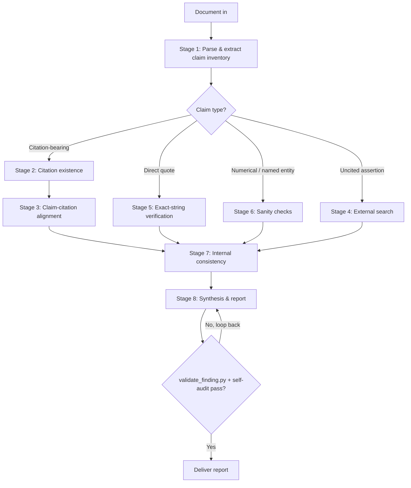

# Research Accuracy Verifier

## Purpose

Verify factual, citation, quotation, and numerical accuracy of LLM-generated research documents — literature reviews, grant text, manuscript drafts, slide decks, reports, white papers, and similar scholarly content. The skill operates as a structured verification pipeline with reproducible evidence trails. Default domain assumption is biomedical / life sciences; the skill also handles general scientific writing.

The goal is a credible, reproducible audit. Most LLM citation errors are subtle (real paper, wrong claim) rather than fully fabricated, and the audit's value collapses if it cries wolf on items it didn't verify.

**Source of truth:** All verdicts, severity assignments, and JSON schemas are defined in [`CONTRACTS.md`](./CONTRACTS.md). This SKILL.md mirrors the contracts for reading convenience; on any disagreement, CONTRACTS.md wins.

## When this skill should NOT trigger

Do not use this skill when the user wants the document edited for style, summarized, expanded with new research, or assessed for novelty / significance. Those are different jobs. If the user asks for any of these *alongside* an accuracy audit, complete the audit first and offer the additional work as a separate next step.

## Initial intake — five questions, asked once

Five questions drive every downstream routing decision. Skipping them produces noticeably worse audits. Ask all five up front in a single consolidated elicitation. Skip any question the user has already answered in prior turns.

The intake answers are emitted as a JSON object validated against [`schemas/intake.json`](./schemas/intake.json):

```jsonc
{
  "document_type":     "grant" | "manuscript" | "lit_review" | "slides" | "report" | "memo" | "other",
  "document_type_other": "string",                                       // required iff document_type == "other"
  "sources_available": "uploaded_files" | "bibliography_only" | "none",
  "verification_tier": "1" | "2" | "3" | "custom",
  "checks_enabled":    ["citation_existence","claim_alignment","uncited_claims",
                        "exact_quotes","numerical_sanity","named_entities","internal_consistency",
                        "prose_quality_audit"],
                                                                         // required iff verification_tier == "custom"
                                                                         // prose_quality_audit is Tier 3 + custom only (parallel pipeline → style_findings[])
  "domain":            "biomedical" | "general" | "mixed",
  "flag_threshold":    "conservative" | "standard" | "strict"
}
```

Tier → `checks_enabled` mapping (computed when tier ≠ `custom`):
- Tier 1 → `["citation_existence"]`
- Tier 2 → `["citation_existence", "claim_alignment"]`
- Tier 3 → all 7 citation-pipeline checks **plus** `prose_quality_audit` (parallel STYLE_NONCONFORMING pass; see CONTRACTS.md §STYLE_NONCONFORMING)

### Required input wrappers

The model **MUST** wrap the document and sources in named XML tags so downstream stages can address them deterministically:

```xml
<intake>
  { ...intake JSON above... }
</intake>

<document>
  ...the full text of the document under review, verbatim...
</document>

<sources>
  <source id="S1" type="pdf"   path="./refs/smith2019.pdf">...optional excerpt or full text...</source>
  <source id="S2" type="doi"   value="10.1038/s41586-020-1234-5"/>
  <source id="S3" type="bib"   path="./refs/library.bib"/>
</sources>
```

`<sources>` is empty `<sources/>` when `sources_available == "none"`.

### Question text (for elicitation)

1. **Document type** — drives parsing strategy and severity weighting:
   `grant` (specific aims, significance, approach) | `manuscript` (intro / results / discussion) | `lit_review` | `slides` | `report` (memo, exec summary) | `memo` | `other` (specify)
2. **Source materials available**: `uploaded_files` (PDFs / .docx / .md / direct paper links) | `bibliography_only` | `none` (external search required for all verification)
3. **Verification tier**: `1` citations only (existence + author/year/journal/DOI) | `2` citations + claim-citation alignment | `3` full (Tier 2 + uncited claims + numbers + quotes + internal consistency + named-entity sanity) | `custom`
4. **Domain**: `biomedical` (PubMed, PMC, bioRxiv, Open Targets, Scite) | `general` (Crossref / OpenAlex first, then web) | `mixed`
5. **Flag threshold**: `conservative` (flag only verified disagreements) | `standard` (disagreement + items that cannot be verified) | `strict` (also flag claims supported by only a single weak source)

## Verification pipeline



### Stage 0 — Resume detection (always runs first)

Long Tier-3 audits can exhaust the context window mid-pipeline. To make audits resumable across sessions, every stage persists its output to `research/audits/<slug>/` (slug = `slugify(document_title)` from intake — see `scripts/checkpoint.py`).

Before Stage 1, call `scripts/checkpoint.py resume --slug <slug>`. The returned `next_stage` says where to begin:

- `next_stage == 1` (fresh or empty dir) → run the full pipeline
- `next_stage == N > 1` → load `claim_inventory.json` and any `0K_<stage>.json` for K in `completed_stages` into working memory, then begin at stage N

A gap in stage artifacts (e.g., 1 and 2 present, 3 missing, 4 present) means the audit must rerun stage 3; the loader stops at the first missing stage. To force a fresh audit, the user deletes `research/audits/<slug>/` before triggering the skill.

### Stage 1 — Document parsing and claim extraction

Build a `ClaimInventory` validated against [`schemas/claim_inventory.json`](./schemas/claim_inventory.json). For each item record `id`, `location {section, paragraph, line}`, `claim_text` (verbatim), `claim_type`, and `citations[]`. Categories:

- **citation_bearing** — any sentence with an inline citation, footnote, or reference marker
- **direct_quote** — text inside quotation marks attributed to a person or source
- **numerical** — percentages, p-values, sample sizes, effect sizes, doses, kinetic parameters (Kd, IC50, EC50), sequence lengths, gene / protein counts, dates
- **named_entity** — gene / protein symbols, drug names (generic and brand), cell lines, antibody clones, mouse strains, instrument models, software versions
- **mechanistic** — causal or mechanistic statements ("X activates Y", "mutation in A causes B")
- **attribution** — "Smith et al. showed…", "the Anderson lab demonstrated…"
- **uncited** — empirical statements with no citation

Build a claim ↔ citation bipartite map: each claim links to zero, one, or many citations; each citation links to all claims it nominally supports.

**On stage completion:** call `checkpoint.py write --slug <slug> --stage 1 --claim-inventory <path> --document-type <type>` to persist the inventory.

### Stage 2 — Citation existence verification

For every cited reference, attempt at least two independent identifier paths before assigning a verdict that downgrades the citation. A single failed lookup is not sufficient — APIs fail intermittently and bad metadata can hide a real paper.

**Routing**:
- DOI / PMID / PMCID resolution via PubMed (biomedical) or Crossref / OpenAlex (general)
- If no identifier provided, search by author + year + title fragment + journal
- **No identifier exists at all — citation is a bare URL** (e.g., `[12] FDA approval letter, https://www.fda.gov/...`, or a citation to a registry / society / preregistration page): the URL itself IS the canonical record. Resolve it via `mcp__exa__web_fetch_exa` (or directly if already known) and verify the page resolves + matches the claim's framing of it (correct date, correct agency, correct action). Satisfy P7 via the **web-source carve-out** (see below — `verification_path[]` entry with `method == "web_search"` + `result_summary` containing the literal token `no_doi`). The URL MUST be on the citable-web-domain whitelist (`skills/shared/references/citable_web_domains.md`); out-of-whitelist URLs fall through to `UNSUPPORTED` with `reason: web_evidence_uncitable_tier`. Capability key: `verification.semantic_web_search`.
- Verify all metadata fields agree: authors (at least first and last), year, journal, volume, pages, DOI
- For journal-volume-year impossibility (e.g., volume X did not exist in year Y), call `scripts/check_journal_volume.py` (capability key: `verification.citation_existence`)
- **Retraction / correction check** (**P7 — validator-enforced; not optional for biomedical/mixed Stage 2**): after identifier resolution succeeds, call `mcp__scite__search_literature` with `dois=[<resolved DOI>]` (no `term`) and inspect the `editorialNotices` field. A clean DOI resolution does NOT exempt the citation from this check — retracted papers resolve cleanly. **The call MUST be logged in `verification_path[]` regardless of outcome.** Three log shapes are valid:
  - Notices found → append `{ "method": "scite_context", "tool": "Scite MCP (search_literature)", "result_summary": "editorialNotices: <notice_type> — <reason>" }`. Verdict becomes `METADATA_MISMATCH` per the assignment table below.
  - Empty / no record (paper not indexed by Scite) → append `{ "method": "scite_context", "tool": "Scite MCP (search_literature)", "result_summary": "editorialNotices: none (Scite returned no record for DOI)" }`. Verdict falls through to the standard assignments.
  - Scite API failure (timeout / rate-limit / wrapper error) → append `{ "method": "scite_context", "tool": "Scite MCP (search_literature) — failed", "result_summary": "probe failed: <api_timeout|empty_response|not_indexed|other>" }`. Verdict still falls through, but the audit trail records the gap.
  - **Web-sourced (no-DOI) evidence carve-out** — when the citation is anchored to a web URL with no DOI resolved (e.g., a Stage-2 finding grounded in an FDA approval letter or EMA assessment report surfaced via `mcp__exa__web_search_exa`), append `{ "method": "web_search", "tool": "mcp__exa__web_search_exa", "result_summary": "web evidence: no_doi available for Scite retraction probe; URL=<resolved-url>, fetched_at=<ISO-8601>" }`. The literal token **`no_doi`** in `result_summary` is what trips the validator's P7 carve-out — a `web_search` entry that omits it is a *dedicated* carve-out violation, not a generic P7 violation, so the LLM is told *why* the check failed. The web URL MUST be on the citable-web-domain whitelist (see `skills/shared/references/citable_web_domains.md`; W1 grounds `VERIFIED` directly, W2/W3a ground with tier-specific `result_summary` tag, W3b is context-only and cannot ground `VERIFIED`). Out-of-whitelist URLs cannot satisfy the carve-out.
  Silence — no Scite entry of any shape AND no `web_search`+`no_doi` carve-out entry — is a **P7 violation** and `validate_finding.py` will reject the finding when invoked with `--domain biomedical --stage 2` (or transitively via `checkpoint.py write --stage 2` when `domain` is threaded through). Capability key: `verification.citation_existence` (Scite path) / `verification.semantic_web_search` (web carve-out). Canonical call shapes: `tool-lookup.yaml` `literature.citation_tallies` (Scite) and `verification.semantic_web_search` (Exa).
- **OpenAlex backstop** (capability key: `verification.citation_existence` fallback): when PubMed AND Crossref both miss for a citation, call `mcp__openalex__batch_resolve_references` with the DOI (or title-author-year tuple) BEFORE declaring `UNSUPPORTED`. OpenAlex covers cross-disciplinary works (CS, physics, social sciences) where PubMed has no coverage. If OpenAlex resolves the work, proceed with metadata-agreement check using OpenAlex's canonical metadata as the reference. If OpenAlex also misses, finalize `UNSUPPORTED` with the full chain in `verification_path[]`. For free-text fallback (fuzzy title match), use `mcp__openalex__search_works` after `batch_resolve_references` returns empty.
- **Venue quality sub-check** (capability key: `verification.venue_quality`): AFTER citation existence resolves a DOI/work, call `mcp__openalex__check_venue_quality` with the venue ID. If quality signals indicate predatory venue, non-indexed venue, or DOAJ-non-membership for an OA-claimed venue, attach as a **sub-reason on a `METADATA_MISMATCH` finding** — do NOT introduce a new verdict subtype. The `result_summary` MUST name the venue concern; the `evidence[]` entry MUST record the OpenAlex venue URL + quality signals. When uncertain whether an unfamiliar venue is "predatory" vs "legitimate-but-niche," call `mcp__openalex__get_top_venues_for_field` to compare against top-N venues for the paper's claimed field. Skip this sub-check silently if OpenAlex venue lookup errors — venue-quality is a sub-check, not a hard gate.

**Verdict assignments** (canonical — see § Canonical Verdicts):
- record exists, all metadata matches → `VERIFIED`
- record exists, ≥1 field disagrees → `METADATA_MISMATCH`
- record exists, `editorialNotices` non-empty (retraction / correction / expression of concern) → `METADATA_MISMATCH`; `result_summary` MUST name the notice type and reason. The cited paper exists, but its retracted/corrected status materially disagrees with the document's implicit framing of it as a sound source.
- record exists, OpenAlex `check_venue_quality` flags predatory / non-indexed venue → `METADATA_MISMATCH` with `result_summary` sub-reason `venue_quality_concern`; the cited paper exists, but the venue's credibility materially disagrees with the document's implicit framing.
- no record found via any identifier path (PubMed → Crossref → OpenAlex `batch_resolve_references`) → `UNSUPPORTED`
- access blocked (paywall, timeout) → `UNVERIFIED` with `reason`

**Hallucination signatures to look for explicitly** (each becomes evidence for `UNSUPPORTED` after multi-path failure):
- Plausible author names with no matching paper
- Real authors paired with titles they never wrote
- DOIs that don't resolve, or resolve to a different paper
- Journal names that don't exist or are off-by-one ("Nature Cellular Biology" vs. "Nature Cell Biology")
- Year / volume mismatches (volume X did not exist in year Y)
- Page ranges inconsistent with journal volume
- Impossible dates (citation predates the cited finding)

**On stage completion:** call `checkpoint.py write --slug <slug> --stage 2 --findings <path> --matrix <path> --document-type <type>`. Findings are validated against `schemas/finding.json` before write; on validation failure, fix the offending finding and retry.

### Stage 3 — Claim-citation alignment

For each claim-citation pair, verify the cited source actually supports the claim attributed to it. This is where most LLM citation errors live: real paper, wrong claim.

**Routing**:
- User-provided source: extract relevant passage; exact-string match for direct quotes (delegate to `scripts/verify_exact_quote.py`); semantic match for paraphrased claims
- No source, abstract available via PubMed: check whether abstract supports, contradicts, or is silent on the claim
- **Biomedical pre-filter — PubTator3 entity co-mention check** (capability: `literature.entity_annotation`). Run BEFORE attempting full-text retrieval when the claim names structured entities (gene/drug/disease/variant) AND a cited PMID is available. Invoke `uv run python skills/shared/scripts/pubtator3.py annotations --pmids <cited_PMID> --summary`; the output is a per-PMID `entity_counts` tally. Outcomes:
  - **All claim entities present in tally** → proceed to PMC/Paperclip for sentence-level alignment (unchanged below).
  - **One or more claim entities absent from tally** → emit candidate verdict `MISATTRIBUTED` with `reason: entity_not_in_pubtator3_annotations` AND attempt one full-text confirmation via Paperclip before finalizing (PubTator3 NER has known gaps for newer papers; absence ≠ ground truth). If full text also lacks the entity, finalize as `MISATTRIBUTED`. If full text contains it, override to `VERIFIED`/`OVERGENERALIZED` per the alignment outcome and record the PubTator3 false-negative in `evidence[]` for downstream measurement.
  - **PubTator3 unreachable / wrapper error** → skip pre-filter silently and continue with the existing routing chain. No hard failure.
- Need full text: attempt PMC fetch; if open access, retrieve and search.
- **PMC fetch failed (paywall / 404), biomedical context**: attempt OA full-text retrieval via Paperclip — `paperclip lookup doi <DOI>` (preferred) or `paperclip search "<title>" -n 1`. If a hit lands in `/papers/<id>/`, read the relevant section files (`/papers/<id>/sections/`) or `paperclip grep "<claim phrase>" /papers/<id>/content.lines` for the alignment check. Record the citation URL `https://citations.gxl.ai/papers/<doc_id>#L<n1>-L<n2>` in the finding's `evidence[]`. Capability key: `verification.claim_alignment` (Paperclip fallback). Skip if cited paper is outside Paperclip's 4-source corpus (PMC + bioRxiv + medRxiv + arXiv) or `paperclip --version` fails.
- **Paperclip miss or unavailable, full text still required**: assign `UNVERIFIED` with `reason: paywalled_full_text`.
- Citation context (sentiment fallback): call `mcp__scite__search_literature` with `dois=[<DOI>]` + `term=<key claim phrase>` to retrieve sentiment-classified citing snippets. Use **supporting** snippets as evidence for `VERIFIED`; use **contrasting** snippets as evidence for `CONTRADICTED` or `OVERGENERALIZED`. Capability key: `verification.claim_alignment` (Scite fallback — lower priority than Paperclip OA full text because snippets are 3-sentence and sentiment-biased). The `result_summary` and any sentiment-attributed claim in the report **MUST** be tagged "per Scite classification" — Scite has documented bias toward 'mentioning' classification (see `tool-lookup.yaml` `literature.citation_context` notes).
- **OpenAlex citation-network backstop** (capability key: `verification.claim_alignment` — last fallback, used only when Scite returns empty for a DOI). Call `mcp__openalex__get_citation_network` with the cited Work ID to surface citing/cited works that may anchor the claim. OpenAlex citation context is **unsentenced** (no supporting/contrasting/mentioning classification); it cannot drive `VERIFIED` vs `CONTRADICTED` on its own. Use only as supporting context for `OVERGENERALIZED` (when the citing-paper-density around the claim is sparse) or as evidence chain documentation when full text is unavailable. The `result_summary` MUST be tagged "unsentenced citation context (per OpenAlex)" to distinguish from Scite's classified snippets. If both Scite and OpenAlex return empty AND no full text is available, the verdict is `UNVERIFIED` with `reason: paywalled_full_text` or `tier_does_not_cover` — never `CONTRADICTED` from absence alone.
- **Cited source is a web URL** (no DOI/PMID/PMCID exists — citation is to a regulatory letter, registry page, society proceedings, or preregistration; e.g., `[12] FDA approval letter, https://www.fda.gov/...`): Paperclip and Scite cannot anchor the claim because there's no DOI to feed them. Fetch the page via `mcp__exa__web_fetch_exa` (or `mcp__exa__web_search_exa` first if only a partial URL is given) and align the claim against the page contents — exact-string for direct quotes, semantic for paraphrased claims. The URL MUST be on the citable-web-domain whitelist (`skills/shared/references/citable_web_domains.md`); W1 grounds `VERIFIED` directly, W2/W3a ground with the tier-specific `result_summary` tag, W3b is context-only (verdict `UNVERIFIED` with `reason: web_evidence_uncitable_tier`, never `VERIFIED`). Out-of-whitelist URLs → `UNVERIFIED` with the same reason. Record `fetched_at` (ISO-8601) and the resolved URL in `evidence[]`. Such Stage-3 `VERIFIED` claims are subject to the P8 web-source carve-out in Stage 4 (see below). Capability key: `verification.semantic_web_search`.
- Claim too specific for abstract-only check and full text unavailable: `UNVERIFIED`, **MUST NOT** flag as `CONTRADICTED`

**Verdict assignments** (canonical):
- source clearly supports the claim → `VERIFIED`
- source supports a weaker / narrower version → `OVERGENERALIZED`
- source explicitly contradicts the claim → `CONTRADICTED`
- source does not address the claim → `MISATTRIBUTED`
- access blocked → `UNVERIFIED` with `reason`

**Logic-failure subtypes to detect within Stage 3** — each maps to an existing verdict (no new vocabulary). These distinguish *how to repair* a flagged claim:

- **Correlation presented as causation** — premise cite is correct but claim language asserts causality the source does not support → `OVERGENERALIZED` if a weaker associative version is supported, otherwise `CONTRADICTED`. Recommended action: soften causal language (e.g., "drives" / "causes" → "is associated with").
- **Overgeneralization** — narrow finding extrapolated to a broader population, setting, or time window → `OVERGENERALIZED`.
- **Non-sequitur** — premises true and individually verifiable, but the conclusion does not follow from them → `MISATTRIBUTED` if the cited source is silent on the conclusion, or `UNSUPPORTED` if no source at all connects premises to conclusion.

Cherry-picking — where the cite-claim pair itself is verified but the document selectively suppressed contradicting literature — is **not** a Stage 3 concern (the cited source genuinely supports the claim) and is handled in Stage 4.

**On stage completion:** persist via `checkpoint.py write --stage 3` (same shape as Stage 2).

### Stage 4 — Uncited claim verification

For substantive uncited claims (depth permitting), search for support.

**Routing**:
- Biomedical: PubMed → bioRxiv (preprints) → PubTator3 (entity-grounded literature when claim names genes/diseases/chemicals/variants) → Open Targets (target / disease / drug claims) → Consensus (paper discovery; full-text-indexed — see operating principle below) → Scite (citation context) → **`mcp__exa__web_search_exa`** (grey-lit / regulatory / registry pages on the citable-web-domain whitelist; capability key `verification.semantic_web_search`)
- General scientific: Crossref / OpenAlex → **`mcp__exa__web_search_exa`** (semantic web search; capability key `verification.semantic_web_search`) → `WebSearch` (deeper fallback when Exa returns empty)

**Web-evidence routing rules** (apply globally — Stages 2, 3, 4, 5 — wherever web evidence enters the audit; documented here under Stage 4 for proximity to the routing tiers above):
- Web URLs MUST be on the citable-web-domain whitelist at `skills/shared/references/citable_web_domains.md`. **W1** (regulatory / registries) grounds `VERIFIED` directly; **W2** (societies / repositories) grounds `VERIFIED` with `result_summary` tag `per society/repository source`; **W3a** (`*.edu`) is treated like W2 with tag `per institutional source`; **W3b** (curated journalism — Nature/Science/NEJM/Lancet/BMJ news, `statnews.com`, `endpts.com`) is **context-only** and CANNOT ground `VERIFIED` on its own — it can only support `UNVERIFIED` (`reason: web_evidence_uncitable_tier`) or `OVERGENERALIZED`.
- Out-of-whitelist URLs cannot ground any verdict in the matrix; they may appear in `verification_path[]` as documentary trail but the `verdict` MUST NOT be `VERIFIED`.
- Every web `verification_path[]` entry MUST capture `fetched_at` (ISO-8601) and a resolvable URL in `result_summary` — C4 (cross-reference integrity, CRITICAL — see `../scientific-writing/references/citation_styles.md` § *Citation Integrity Rules (TWS C1–C5)*) requires URL resolvability at audit time.
- A web `verification_path[]` entry with `method == "web_search"` MUST include the literal token `no_doi` in `result_summary` when used to satisfy P7 (Stage 2). See the P7 web-source carve-out above.

Capability keys: `verification.citation_existence`, `verification.claim_alignment`, `verification.semantic_web_search`. The LLM invokes the corresponding MCP tools (PubMed, Scite, Exa, etc.) directly per the call patterns documented in `tool-lookup.yaml`, and records each call as a `verification_path[]` entry.

Verdict assignments: same as Stage 3.

**Cherry-picking detection** (**P8 — validator-enforced; Tier 3 biomedical/mixed audits, and custom audits with `uncited_claims` enabled**): for every already-`VERIFIED` cite-claim pair emitted by Stage 3 in the `verification_matrix[]`, sweep Scite for tally-based contested-consensus detection. Two valid outcomes per Stage-3 VERIFIED claim:

- **Cherry-picking finding emitted.** Call `mcp__scite__search_literature` with `dois=[<cited DOI>]` (no `term`) to fetch the citation tally. Compute `USI = supporting / (supporting + contrasting)`. If `USI < 0.5` (matches deep-research's `[CONTESTED]` threshold), emit a Stage-4 finding with `verdict == "OVERGENERALIZED"`, `verification_path[]` containing at least one `method == "scite_context"` entry, and a `result_summary` containing **both** (a) the literal tag `cherry_picking:<claim_id>` — where `<claim_id>` exactly matches the `verification_matrix[].claim_id` of the Stage‑3 VERIFIED claim this finding covers — and (b) the literal pattern `USI=<value>` plus supporting/contrasting counts. The tag is what lets `validate_audit_report.py` pair the Stage‑4 finding with its originating Stage‑3 claim. The "claim" being overgeneralized is the implicit consensus framing, not the narrow cite-claim pair (which remains `VERIFIED` in the matrix). Tag the `result_summary` "per Scite classification". Recommended action: add a contrasting citation or scope-limit the claim.
- **Caveat in lieu of finding.** When the Scite tally cannot be computed (DOI not indexed by Scite, API failure, USI ≥ 0.5 so no `OVERGENERALIZED` is warranted), the Stage‑3 VERIFIED claim MUST still be accounted for via a `header.coverage_caveats[]` entry of structured shape `cherry_picking:<claim_id>: <reason>`. The `<claim_id>` MUST exactly match the `verification_matrix[].claim_id`. The `<reason>` is free-form text but should name the actual outcome (`scite_doi_not_indexed`, `api_timeout`, `tally_uncontested_USI=0.83`, `tally_empty`, etc.). The `cherry_picking:` prefix is parsed by `validate_audit_report.py` / `render_report.py`.
- **Web-sourced VERIFIED claims carve-out.** Stage‑3 `VERIFIED` claims grounded in web evidence (no DOI) cannot be swept via Scite tally — there's no DOI to compute USI against. They MUST still be covered via the caveat path: emit a `header.coverage_caveats[]` entry of canonical shape `cherry_picking:<claim_id>: web_source_no_doi_for_scite_tally`. The reason token `web_source_no_doi_for_scite_tally` signals the carve-out explicitly; `validate_audit_report._caveat_covers_claim` already parses the `cherry_picking:<claim_id>: <reason>` prefix without modification, so no validator change is needed — but the Stage 4 emit logic MUST produce the caveat. Out-of-whitelist web URLs would not have reached `VERIFIED` in Stage 3 (see Stage 3 web-evidence routing rules), so any Stage-3 `VERIFIED` web claim reaching Stage 4 is already a W1/W2/W3a hit.

Silence — a Stage‑3 VERIFIED claim with no matching cherry-picking finding **and** no `cherry_picking:<claim_id>:` caveat (Scite-based or web-source carve-out) — is a **P8 violation**. The audit cannot be rendered: `render_report.generate_report()` invokes `validate_audit_report.run_p8(...)` and raises on failure. Capability key: `verification.cherry_picking`.

**On stage completion:** persist via `checkpoint.py write --stage 4`.

### Stage 5 — Quotation verification

Direct quotes require exact-string verification. Paraphrase-presented-as-verbatim is a distinct severity from a missing or contradicted quote.

**Procedure** — delegate to `scripts/verify_exact_quote.py` (capability key: `verification.exact_quote`):
- Source provided → exact-string + whitespace-normalized search in source via the script.
- No source, **biomedical context** (and `paperclip --version` succeeds) → corpus-wide exact-phrase grep over full text: `paperclip grep -F "<exact passage>" /papers/`. Capability key: `verification.exact_quote` (primary). The CLI returns paper IDs and per-paper match counts with file paths and line numbers (`/papers/<id>/sections/<file>:L<n>`). Sandbox blocks `for`/`while`/`xargs` — use multiple tool calls instead of loops.
- No source, Paperclip unavailable or non-biomedical → call `mcp__exa__web_search_exa` with the quoted phrase as a natural-language query (`numResults: 5`); for each promising hit, call `mcp__exa__web_fetch_exa` on the URL to retrieve clean markdown and grep for the exact phrase. `WebSearch` is the deeper fallback when Exa returns empty (regional restriction, rate limit, or query truly off-corpus). Capability key: `verification.semantic_web_search` (Exa primary) / `verification.exact_quote` (web fallback). Web-discovered quote rescues MUST still record the resolved URL + `fetched_at` in the finding's `evidence[]`; the citable-web-domain whitelist applies (W3b context-only — a quote located only on a journal news desk cannot itself become the citation, but it can guide the LLM to the underlying primary source).
- **Rescue path for `QUOTE_FABRICATED`**: when `verify_exact_quote.py` returns `QUOTE_FABRICATED` (quote not found in the *claimed* source), run `paperclip grep -F "<exact passage>" /papers/` before finalizing the finding. If the quote is real but in a different paper, the verdict **stays `QUOTE_FABRICATED`** (the original cite-claim pair is still wrong) — but the finding's `evidence[]` MUST record the discovered true source's citation URL (`https://citations.gxl.ai/papers/<doc_id>#L<n1>-L<n2>`), and the `recommended_action` MUST be "re-attribute the quote to <discovered source>" rather than "remove the quote." This preserves the canonical verdict-origin partition (Stage 5 emits only `QUOTE_*` verdicts) while distinguishing recoverable misattribution from genuinely fabricated text in the remediation guidance.
- Verify attribution (right person, right context)
- Verify date / venue if specified

**Verdict assignments** (canonical, only valid when `claim_type == "direct_quote"`):
- exact match → `QUOTE_VERIFIED`
- text differs from source → `QUOTE_PARAPHRASED`
- no matching text in claimed source → `QUOTE_FABRICATED` (when corpus rescue locates the quote in a different paper, verdict is unchanged but `evidence[]` records the discovered true source and `recommended_action` switches to re-attribution)

**On stage completion:** persist via `checkpoint.py write --stage 5`.

### Stage 6 — Numerical and named-entity sanity checks

**Cooperation with `research-paper-summarizer`:** when the document under audit cites a paper that has already been summarized by `research-paper-summarizer`, the per-paper `{stem}_stats.json` file (schema: [`../research-paper-summarizer/schemas/stats.json`](../research-paper-summarizer/schemas/stats.json)) is the canonical numerical record for that **cited** paper. The handoff is explicit:

1. **Caller populates `intake.cited_papers[]`** (schema: `schemas/intake.json#/properties/cited_papers`) by lifting each upstream summarizer's fork-return `summary_paths.{stats,source_meta}` into a `{paper_id, stats_path, source_meta_path[, doi, pmid, pmcid]}` entry. This is the only formal way the verifier learns where stats files live — there is no path scan or heuristic discovery.
2. **Stage 6 iterates `cited_papers[]`** in the order presented. For each entry: `!\`cat <stats_path>\`` to load it, `!\`uv run python ../research-paper-summarizer/scripts/validate_stats.py <stats_path>\`` to confirm Q5/R5 compliance (skip the entry on non-zero exit and log `header.coverage_caveats[]`), then join the document's numerical claims to the loaded stats by matching `paper_id` and value/unit/context.
3. **Emit `evidence` entries** that pin to `paper_id` + `claim_id` from `stats.json`. Verdict assignment follows the standard enum: matching number → `VERIFIED`; conflicting number → `CONTRADICTED`; missing from stats but plausible → `UNVERIFIED`.

**Fallback:** when `cited_papers[]` is absent from intake, or an entry's `validate_stats.py` fails, Stage 6 falls back to full-text re-extraction from the cited paper (Paperclip / PMC). The cooperation eliminates 10–30k tokens per cited paper and prevents verdict drift from independently re-derived numbers. (This cooperation applies to **cited sources** only — number sanity within the document under audit itself still uses the heuristics below.)

**Numerical claims** (`scripts/check_journal_volume.py` and number sanity heuristics):
- p-values with implausible precision (≥4 decimal places) or non-standard formatting
- effect sizes outside biologically plausible ranges
- sample sizes inconsistent with described study design or stats
- dates that conflict with cited paper publication years
- **anachronistic temporal claims** — explicit recency phrases ("as of last year", "current data", "recent studies") anchored to a year that no longer qualifies as recent (≥18 months before `date_checked`) → `OVERGENERALIZED` (the claim asserts currency the source does not support). Per matrix, MAJOR for grant / manuscript / lit_review. Recommended action: replace the recency phrase with an explicit cutoff date.
- **anachronistic evidence base** (no specific recency claim, but the latest cited reference year lags `date_checked` by ≥18 months in a fast-moving field) → emit a `header.coverage_caveats[]` entry rather than a `findings[]` entry; this is a coverage gap, not a misstatement. Recommended action: refresh the evidence base or scope-limit the document.

**Named entities** — delegate to `scripts/resolve_entity.py` (which delegates to the `entity-resolution` skill):
- Gene / protein symbols: verify official symbol via HGNC / UniProt; flag aliases that may obscure entity confusion
- Drug names: verify generic ↔ brand correspondence
- Cell lines: cross-check Cellosaurus; flag known misidentified or contaminated lines
- Mouse strains: verify against official Jackson Laboratory or Charles River nomenclature
- Antibody clones: flag claims requiring validation when no clone or RRID is given

Verdict assignments: `VERIFIED | METADATA_MISMATCH | CONTRADICTED | MISATTRIBUTED | UNVERIFIED`.

**On stage completion:** persist via `checkpoint.py write --stage 6`.

### Stage 7 — Internal consistency

Cross-check the document against itself. Stage 7 work is largely deterministic and is delegated to scripts:

- `scripts/reconcile_references.py` — bibliography ↔ inline citation set diff (orphan refs, missing inline)
- `scripts/scan_acronyms.py` — acronym defined-before-first-use, expansion drift

The LLM still adjudicates:
- The same fact stated with different numbers in different sections → `CONTRADICTED`
- Discussion claims not supported by results presented → `UNSUPPORTED` or `OVERGENERALIZED`
- Definitions that drift across sections → `METADATA_MISMATCH`
- Author / year mismatches between inline citations and bibliography → `METADATA_MISMATCH`

**On stage completion:** persist via `checkpoint.py write --stage 7`.

### Stage 8 — Synthesis and reporting

Assemble the report per `schemas/audit_report.json`. **MUST** call `scripts/validate_finding.py` on every finding before assembling the report — passing `--domain <intake.domain>` and `--stage <originating-stage>` so predicate **P7** (Stage-2 Scite probe) fires. On per-finding validation failure, loop back to the offending stage rather than deliver an incomplete report.

**MUST** then call `scripts/validate_audit_report.py <audit_report.json> --intake <intake.json>` to enforce predicate **P8** (Tier-3 cherry-picking sweep). On P8 failure, loop back to Stage 4 — emit either the missing cherry-picking finding(s) or a `cherry_picking:<claim_id>: <reason>` coverage caveat for each uncovered Stage-3 VERIFIED claim. P8 is also enforced transitively: `render_report.generate_report()` invokes `validate_audit_report.run_p8(...)` and raises on failure, so the markdown cannot render past a P8 violation even if the LLM skips the CLI step.

Render the markdown report via `scripts/render_report.py` (`generate_report(audit_report_dict, intake=...) → str`). When resuming from a partial audit, merge `findings[]` and `verification_matrix[]` from all loaded `0N_<stage>.json` artifacts before assembly. Write the final `audit_report.json` to `research/audits/<slug>/audit_report.json` alongside the per-stage artifacts.

## Canonical verdicts

The single vocabulary used by every stage. Defined in [`CONTRACTS.md`](./CONTRACTS.md); reproduced here for reference. Glyphs (✅⚠️❌❓) are no longer used as verdict markers; severity is rendered in the report instead.

| Verdict | Origin | Meaning |
|---|---|---|
| `VERIFIED` | 2 | Citation exists; metadata fields agree |
| `METADATA_MISMATCH` | 2 | Record exists; ≥1 field disagrees |
| `UNSUPPORTED` | 2 / 3 | No identifier path resolves; or source does not contain the claim |
| `OVERGENERALIZED` | 3 | Source supports a weaker / narrower version |
| `CONTRADICTED` | 3 / 7 | Source explicitly contradicts the claim |
| `MISATTRIBUTED` | 3 | Source does not address this claim |
| `QUOTE_VERIFIED` | 5 | Quoted text matches source |
| `QUOTE_PARAPHRASED` | 5 | Paraphrase presented as verbatim |
| `QUOTE_FABRICATED` | 5 | No matching text in claimed source |
| `UNVERIFIED` | any | Could not complete verification; **MUST** include `reason` |

`UNVERIFIED.reason`: `paywalled_full_text | preprint_not_indexed | api_timeout | source_not_provided | tier_does_not_cover | other`

## Severity matrix (Verdict × DocumentType)

Severity is **computed**, not assigned. `validate_finding.py` rejects findings whose `severity` does not match this table.

| Verdict \ DocType | grant | manuscript | lit_review | slides | report | memo | other |
|---|---|---|---|---|---|---|---|
| VERIFIED | INFO | INFO | INFO | INFO | INFO | INFO | INFO |
| METADATA_MISMATCH | MAJOR | MAJOR | MAJOR | MINOR | MINOR | MINOR | MINOR |
| UNSUPPORTED | CRIT | CRIT | CRIT | MAJOR | MAJOR | MINOR | MAJOR |
| OVERGENERALIZED | MAJOR | MAJOR | MAJOR | MAJOR | MINOR | MINOR | MAJOR |
| CONTRADICTED | CRIT | CRIT | CRIT | CRIT | MAJOR | MAJOR | CRIT |
| MISATTRIBUTED | CRIT | CRIT | CRIT | MAJOR | MAJOR | MINOR | MAJOR |
| QUOTE_VERIFIED | INFO | INFO | INFO | INFO | INFO | INFO | INFO |
| QUOTE_PARAPHRASED | MAJOR | MAJOR | MAJOR | MINOR | MINOR | MINOR | MINOR |
| QUOTE_FABRICATED | CRIT | CRIT | CRIT | MAJOR | MAJOR | MAJOR | CRIT |
| UNVERIFIED | INFO | INFO | INFO | INFO | INFO | INFO | INFO |

Cells: `CRIT` = CRITICAL, `MAJOR` = MAJOR, `MINOR` = MINOR, `INFO` = INFORMATIONAL.

**Threshold modifier** (`flag_threshold`):
- `conservative` — emit only findings whose verdict ∈ `{CONTRADICTED, MISATTRIBUTED, UNSUPPORTED, QUOTE_FABRICATED}`; suppress UNVERIFIED from `findings[]` (still in `verification_matrix[]`)
- `standard` (default) — emit per matrix
- `strict` — emit per matrix; promote `METADATA_MISMATCH` and `OVERGENERALIZED` findings with single-source `verification_path` by one severity level

## Operating principles (positive predicates, validator-enforced)

These are not guidelines — they are enforced by `validate_finding.py`. Findings that violate them are rejected, forcing a Stage-8 loop-back.

- **MUST** populate `verification_path[]` with ≥2 distinct entries before assigning `severity == CRITICAL`. (Predicate P2 in CONTRACTS.md.)
- **MUST** include ≥1 `evidence[]` entry with a resolvable URL / PMID / DOI for every finding. (P3.)
- **MUST** use `verdict == UNVERIFIED` with a specific `reason` when verification access is incomplete. (P1.)
- **MUST NOT** emit `severity == CRITICAL` when `verdict == UNVERIFIED`. (P1.)
- **MUST** restrict verdicts ∈ `{QUOTE_VERIFIED, QUOTE_PARAPHRASED, QUOTE_FABRICATED}` to claims with `claim_type == "direct_quote"`. (P4.)
- **MUST** compute `severity` from the matrix in `schemas/severity_matrix.values.json`; user-supplied severities that disagree are rejected. (P5.)
- **MUST** include a `method == "scite_context"` (or `tool` ~ `/scite/i`) entry in every biomedical/mixed Stage‑2 finding's `verification_path[]` whose verdict is `VERIFIED`, `METADATA_MISMATCH`, or `UNSUPPORTED` — even on Scite API failure (log the failure mode in `result_summary`). Silence is a violation. (P7.)
- **MUST** cover every Stage‑3 `VERIFIED` claim in a biomedical/mixed Tier‑3 audit (or `custom` audit with `uncited_claims` enabled) with **either** a matching Stage‑4 cherry-picking finding (`OVERGENERALIZED`, `scite_context`, `USI=` in `result_summary`) **or** a `header.coverage_caveats[]` entry of structured shape `cherry_picking:<claim_id>: <reason>`. (P8.)
- **MUST** treat Consensus's natural-language synthesis output as a routing aid, not primary evidence — when a synthesis points at a finding, cite the underlying paper, not the synthesis text or aggregator URL (e.g., `consensus.app/papers/...`). **Paper search results returned by Consensus (DOIs, titles, abstracts) are first-class scholarly references** and should be cited like any other PubMed/OpenAlex hit; they carry a discovery advantage because Consensus indexes full-text server-side, surfacing papers where the answer lives in methods/results rather than the abstract.
- **MUST** quote the original document verbatim when reproducing a claim in the report (so the user can locate the passage); paraphrase external sources per copyright norms.
- **MUST** state coverage gaps prominently in `header.coverage_caveats[]` when full-text access blocks a tier-3 check.
- **MUST** suffix every Scite-derived sentiment claim with "per Scite classification" in the finding's `result_summary`, and emit a coverage caveat noting Scite's documented bias toward 'mentioning' classification in `header.coverage_caveats[]` whenever any finding's `verification_path[]` includes `method == "scite_context"`. The caveat is auto-propagated by `scripts/render_report.py`; the per-finding tag is the LLM's responsibility.

## Output format

Default to markdown for Obsidian compatibility. Render via `scripts/render_report.py` from a JSON object validated against `schemas/audit_report.json`.

The report contains:

### Header

`document_title`, `document_type`, `date_checked`, `verification_tier`, `sources_consulted[]`, `overall_confidence` (`high | moderate | low | very_low`) with one-paragraph `confidence_justification`, and `coverage_caveats[]` called out prominently.

`overall_confidence` is computed:
- `high` — 0 CRITICAL findings, ≤1 MAJOR, no UNVERIFIED beyond depth-tier scope
- `moderate` — ≤2 CRITICAL, or ≤5 MAJOR, or some UNVERIFIED inside scope
- `low` — 3–5 CRITICAL, or pervasive MAJOR, or large UNVERIFIED population
- `very_low` — ≥6 CRITICAL, or evidence of systemic hallucination

### Executive summary

3–5 sentence prose summary covering: total claims checked, count flagged at each severity, the most consequential issues, and an overall recommendation.

Examples:
- "Document is broadly reliable but contains 2 CRITICAL citation errors and 1 MISATTRIBUTED quote that must be corrected before submission."
- "Document contains pervasive citation hallucination (7 of 18 references could not be verified via any identifier path). Recommend rebuilding the bibliography from primary sources."

### Findings, organized by severity

CRITICAL → MAJOR → MINOR → INFORMATIONAL.

For each finding render this table (one per finding):

| Field | Content |
|---|---|
| Location | Section, paragraph (line if available) |
| Claim (verbatim) | Quoted exactly from the document |
| Verification path | Methods + tools (≥1; ≥2 if CRITICAL) |
| Evidence | PMIDs, DOIs, URLs, source quotes |
| Verdict | One of the canonical 10 |
| Severity | Computed from matrix |
| Recommended action | Fix / replace citation / soften claim / verify with full text / etc. |
| Confidence | `high | medium | low` |
| Reason (if UNVERIFIED) | One of the 6 enum values |

#### Worked example — CRITICAL finding

| Field | Content |
|---|---|
| **Location** | Significance, paragraph 3, line 42 |
| **Claim (verbatim)** | "Anti-PD-1 monotherapy in the CT26 syngeneic colon model achieves complete response rates of 47% (Chen et al., 2019, *Nature Cancer* 5:1123–1135)." |
| **Verification path** | (1) `doi_lookup` via Crossref — no DOI provided; (2) `pubmed_search` by author + year + title fragment + journal — 0 hits; (3) `journal_volume_check` (Crossref ISSN 2662-1347) — *Nature Cancer* volume 1 first published Jan 2020, so volume 5 in 2019 is impossible; (4) `pubmed_search` for any Chen et al. paper on CT26 + PD-1 in 2018–2020 — no candidate matches the claimed title or response rate. |
| **Evidence** | *Nature Cancer* journal start year per Crossref ISSN 2662-1347: January 2020. No PubMed / Crossref record matches author/year/title/journal/volume combination. |
| **Verdict** | `UNSUPPORTED` |
| **Severity** | CRITICAL (matrix: UNSUPPORTED × manuscript = CRITICAL) |
| **Recommended action** | Replace with a verified source. Selby et al. 2013 (PMID:23300641) reports CT26 anti-PD-1 response data; or Mosely et al. 2017 (PMID:29097623) for syngeneic-model checkpoint response benchmarks. The 47% number itself is unsupported and **MUST** be re-verified against whichever source is substituted. |
| **Confidence** | high |

#### Optional remediation prompts in `recommended_action`

For findings where the original drafter is still in the loop (e.g., the user is iterating with an LLM), `recommended_action` MAY suffix one stress-test prompt the user can send back to the drafter. These are author-facing suggestions, not validator-enforced text:

- `CONTRADICTED` → Re-prompt the drafter: *Using the same source, argue the opposite conclusion. If you can construct an equally strong argument, this claim needs revision.*
- `OVERGENERALIZED` → Re-prompt the drafter: *What evidence would need to exist for this conclusion to be false? List the specific assumptions you've made.*
- Cherry-picking flagged in Stage 4 → Re-prompt the drafter: *Give me the strongest counterargument before I accept this — including any contradicting studies you may have omitted.*

These prompts are useful when the document is still in active drafting; omit them when auditing a frozen submission.

### Verification matrix (appendix)

A complete table mapping every claim → verification source(s) → verdict, including unflagged items, so the user has a full audit trail.

### Methodology note

Brief description of which sources were queried in what order, depth tier executed, and any limitations.

## Connector and tool priority

In priority order, for biomedical documents (capability keys in `skills/shared/tool-lookup.yaml`):

1. **PubMed MCP** (`verification.citation_existence` primary) — citation existence, abstract retrieval, related articles
2. **User-provided source materials** — ground truth
3. **bioRxiv MCP** — preprint coverage
4. **Open Targets MCP** — target / disease / drug claims
5. **Scite MCP** (`verification.citation_existence` primary, `verification.claim_alignment` fallback, `verification.cherry_picking` primary) — `editorialNotices` for retraction / correction detection (Stage 2), sentiment-classified citing snippets for claim alignment (Stage 3), citation tallies + Scite Index for cherry-picking detection (Stage 4 Tier 3). All sentiment outputs reported "per Scite classification" — bias caveat documented at `tool-lookup.yaml` `literature.citation_context`.
6. **Crossref** via web fetch + **OpenAlex MCP** (`verification.citation_existence` fallback, `verification.venue_quality` primary, `verification.claim_alignment` last fallback) — DOI resolution + cross-disciplinary metadata via `mcp__openalex__batch_resolve_references` (called when PubMed and Crossref both miss); free-text fallback via `mcp__openalex__search_works`. Venue quality sub-check via `mcp__openalex__check_venue_quality` (predatory / non-indexed venue → `METADATA_MISMATCH` sub-reason `venue_quality_concern`). Citation-network backstop via `mcp__openalex__get_citation_network` when Scite returns empty for a DOI — unsentenced context, never drives `VERIFIED` vs `CONTRADICTED` on its own.
7. **PMC** via web fetch (`verification.claim_alignment` primary) — open-access full text for alignment
8. **PubTator3 wrapper** (`literature.entity_annotation` primary for biomedical Stage 3 pre-filter; ahead of Paperclip) — entity-grounded BioC-JSON annotations for cited PMIDs. Cheap deterministic check: does the cited paper actually annotate the (gene, disease, chemical, variant) tuple the claim names? Used to short-circuit `MISATTRIBUTED` candidates before paying for full-text retrieval. Absence is escalated to Paperclip (NER gaps), not used as a hard verdict. Wrapper at `skills/shared/scripts/pubtator3.py`; degrades silently on network or wrapper error. Verdict reason: `entity_not_in_pubtator3_annotations` under `MISATTRIBUTED`.
9. **Paperclip CLI** (`verification.exact_quote` primary for Stage 5; `verification.claim_alignment` fallback for Stage 3, ahead of Scite snippets) — corpus-wide regex over PMC + bioRxiv + medRxiv + arXiv (4 sources) for no-source quote verification and `QUOTE_FABRICATED` rescue; OA full-text retrieval when PMC fetch fails. CLI transport only (vendor SKILL.md at `.claude/skills/paperclip/SKILL.md`); degrades silently if `paperclip --version` exits non-zero. Does **not** replace Scite for retraction (`citation_existence`) or cherry-picking (`cherry_picking`) — Paperclip has no `editorialNotices` equivalent. Capability keys: `literature.corpus_search`, `literature.corpus_grep`.
10. **Consensus MCP** (`literature.search` primary) — paper discovery across Semantic Scholar + PubMed + Scopus + arXiv with server-side full-text-indexed ranking; surfaces papers where the answer lives in methods/results rather than the abstract. Paper results (DOIs, titles, abstracts) are first-class citations. Consensus's natural-language synthesis output (when surfaced) is a routing aid only — cite the underlying paper, never the synthesis.
11. **Exa** via web — semantic search when keyword search fails
12. **Web search** (`verification.exact_quote` fallback) — fallback for everything else; fallback path for exact-quote verification when Paperclip is unavailable or context is non-biomedical
13. **`entity-resolution` skill** (`verification.entity_sanity` delegate) — gene / drug / disease ID resolution

For general scientific documents, lead with Crossref + OpenAlex MCP (`mcp__openalex__batch_resolve_references` → `mcp__openalex__search_works` → `mcp__openalex__get_citation_network` for snowballing); use PubMed only when the topic crosses into life sciences.

## Special domain handling — Oligon / aptamer-siRNA / immuno-oncology

When document content concerns aptamer-siRNA chimera biology, T-cell exhaustion, immune checkpoint biology, or oncology preclinical models, apply additional domain-specific checks:

- **Aptamer claims**: length, modifications (2′-F, 2′-OMe, LNA, PS backbone), chemistry are accurately described and consistent with cited source
- **siRNA design**: strand polarity (sense / antisense / guide / passenger usage), modification chemistry, IC50 reporting conventions, off-target predictions
- **Cell-line provenance**: ATCC / JCRB / DSMZ IDs where relevant; flag known misidentified lines
- **Mouse model nomenclature**: official Jackson / Charles River strain designations; verify syngeneic model–host strain compatibility (CT26 / BALB-c, MC38 / C57BL-6, B16 / C57BL-6, 4T1 / BALB-c, ID8 / C57BL-6)
- **Statistical tests**: appropriateness for described data type (parametric vs. non-parametric, paired vs. unpaired, multiple-comparison correction)
- **Antibody / clone identifiers**: RRIDs preferred; flag claims requiring validation when no clone is named

## Self-audit (automated, runs in Stage 8)

Before delivering the report, the following validators **MUST** pass:

1. `scripts/validate_finding.py --batch findings.json --document-type <type> --domain <domain>` (per-finding P1–P5 + P7). The Stage attribute is supplied implicitly when the validator is invoked via `checkpoint.py`; when calling the CLI directly, pass `--stage <originating-stage>` so P7 fires for biomedical Stage-2 findings.
2. `scripts/validate_audit_report.py audit_report.json --intake intake.json` (cross-stage P8). Enforces the Tier-3 cherry-picking sweep over Stage-3 VERIFIED claims.
3. Every claim in the inventory appears in either `findings[]` or `verification_matrix[]`.
4. Severity is consistent with the matrix.
4. Original document wording is preserved exactly when quoted (string equality against `<document>` content).
5. Coverage caveats are populated whenever a tier-3 check was requested but blocked.

Validator failure forces Stage-8 loop-back. The skill **MUST NOT** deliver a report whose findings have not passed the validator.

## Background reading

The following references in `references/` provide non-technical conceptual grounding for the verification frameworks operationalized by this skill. They are useful for understanding *why* the pipeline is structured the way it is, but the skill itself never reads them at runtime — they are for human reference only.

- `Fact-Checking AI - How to spot Errors and Reduce Hallucinations.md` — full course transcript (Birss, Gen AI Academy, 2026); covers the three error flavors (phantom statistic, dead citation, reasoning error in true data), six pre-verification red flags, four logic-failure types, and a three-step verification workflow (risk triage → verify by type → second opinion)
- `Fact-Check AI - Course Workbook.pdf` — pocket-reference summary of the same frameworks

What this skill **does** implement from Birss's frameworks: three-error-flavor detection (Stage 2), verify-by-type ordering (Stages 2 → 3 → 6), risk triage (verification_tier × flag_threshold × severity matrix), and the four logic-failure subtypes (Stages 3 and 4).

What this skill **does not** implement: pre-verification red-flag triage (no Stage 1 priority signals; deferred), second-LLM critique as a workflow step (the existing Stage 8 self-audit is schema validation via `validate_finding.py`, not a second-model critique), and Birss's "six honesty prompts" / "autonomy ladder" — these target document drafting and agent-action governance, which are separate concerns from post-hoc document audit (this skill's sole responsibility — see `## Out of scope`).

## Out of scope

- Editing the document for style, grammar, or clarity
- Adding new research or expanding sections
- Producing a literature review on the document's topic
- Judging the scientific novelty or significance of claims (only their accuracy)
- Reproducing computational analyses or re-running statistics
- HTML / docx / annotated-PDF output (markdown only in v1.2; HTML via oligon-brand deferred to v1.3)

If the user asks for any of these alongside accuracy checking, complete the audit first and offer the additional work as a separate next step.

## Fork-return contract

This skill runs in a forked subagent context (`context: fork`). The fork executes all 8 stages internally — full-text retrieval (Paperclip, PMC, Scite), claim extraction, quote regex, numerical sanity, schema validation — and returns **only a compact summary** to the calling conversation. All evidence stays in `research/audits/<slug>/`.

The fork's final message to the caller is a single JSON object capped at ~800 tokens. Emit it verbatim as the last content of the response, fenced as ```json:

```jsonc
{
  "audit_id": "<slug>",
  "audit_dir": "research/audits/<slug>/",
  "verdict_counts": {
    "VERIFIED": 0, "METADATA_MISMATCH": 0, "UNSUPPORTED": 0, "OVERGENERALIZED": 0,
    "CONTRADICTED": 0, "MISATTRIBUTED": 0, "QUOTE_VERIFIED": 0,
    "QUOTE_PARAPHRASED": 0, "QUOTE_FABRICATED": 0, "UNVERIFIED": 0
  },
  "severity_counts": { "CRITICAL": 0, "MAJOR": 0, "MINOR": 0, "INFORMATIONAL": 0 },
  "style_summary": {
    "enabled": false,
    "total": 0,
    "critical": 0
  },
  "top_findings": [
    { "id": "F-NN", "verdict": "<enum>", "severity": "<enum>", "rationale": "<≤140 chars>" }
  ],
  "predicate_audit": { "P1": "pass", "P2": "pass", "P3": "pass", "P4": "pass", "P5": "pass", "P7": "pass", "P8": "pass" },
  "report_paths": {
    "json": "research/audits/<slug>/audit_report.json",
    "markdown": "research/audits/<slug>/report.md"
  },
  "next_actions": [ "<≤2 short suggestions or empty array>" ]
}
```

**Required fields:** `audit_id`, `audit_dir`, `verdict_counts` (one count for each of the 10 canonical Finding verdicts from CONTRACTS.md §Verdict enum, zero if absent — this is `findings[]` only, not `style_findings[]`), `severity_counts`, `style_summary` (set `enabled: false` and zeros for non-Tier-3 audits where `prose_quality_audit` is not in `checks_enabled`; otherwise `total` is `len(style_findings)` and `critical` counts the four canonical CRITICAL style rules W6/AI8/Q5/R5), `predicate_audit` (P1–P5, P7, P8 from CONTRACTS.md — P7/P8 emit `"pass" | "fail" | "n/a"`; `"n/a"` when the predicate's trigger conditions did not apply for this audit, e.g., P7 on a general-domain audit or P8 outside Tier 3), `report_paths`. `top_findings` MUST be the up to three highest-severity findings ordered by severity descending, drawing from `findings[]` only (style findings surface separately via `style_summary`); rationales must be ≤140 characters and contain no quoted excerpts or full claim text.

**Forbidden in fork return:** raw claim text, quoted source excerpts, full-text snippets, MCP tool responses, paperclip output, intermediate stage findings (those live in `research/audits/<slug>/stage*.json`). The caller follows up with targeted reads — for example, `!\`jq '.findings[] | select(.id=="F-NN")' research/audits/<slug>/audit_report.json\`` — to surface specific finding details on demand at zero token cost in the main context.

**If the audit cannot complete:** still return the JSON shape with `verdict_counts` reflecting findings produced so far, `predicate_audit` showing which predicates passed before the abort, and a `next_actions` entry explaining what blocked completion (e.g., `"resume after providing source PDFs"`). Partial state remains in `research/audits/<slug>/` for `checkpoint.py resume --slug <slug>` to pick up.
