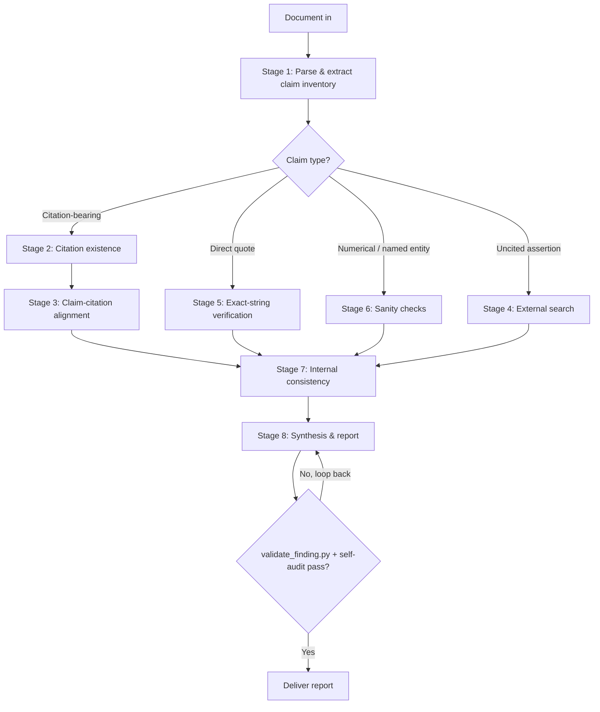

# Research Accuracy Verifier

## Purpose

Verify factual, citation, quotation, and numerical accuracy of LLM-generated research documents — literature reviews, grant text, manuscript drafts, slide decks, reports, white papers, and similar scholarly content. The skill operates as a structured verification pipeline with reproducible evidence trails. Default domain assumption is biomedical / life sciences; the skill also handles general scientific writing.

The goal is a credible, reproducible audit. Most LLM citation errors are subtle (real paper, wrong claim) rather than fully fabricated, and the audit's value collapses if it cries wolf on items it didn't verify.

**Source of truth:** All verdicts, severity assignments, and JSON schemas are defined in [`references/CONTRACTS.md`](./references/CONTRACTS.md). SKILL.md is a routing skeleton; per-stage detail lives in [`references/stages/`](./references/stages/) and the predicate contract in [`references/predicates.md`](./references/predicates.md). On any disagreement, CONTRACTS.md wins.

## When this skill should NOT trigger

Do not use this skill when the user wants the document edited for style, summarized, expanded with new research, or assessed for novelty / significance. Those are different jobs. If the user asks for any of these *alongside* an accuracy audit, complete the audit first and offer the additional work as a separate next step.

## Initial intake — five questions, asked once

Five questions drive every downstream routing decision. Skipping them produces noticeably worse audits. Ask all five up front in a single consolidated elicitation. Skip any question the user has already answered in prior turns.

The intake answers are emitted as a JSON object validated against [`schemas/intake.json`](./schemas/intake.json):

```jsonc
{
  "document_type":     "grant" | "manuscript" | "lit_review" | "slides" | "report" | "memo" | "other",
  "document_type_other": "string",                                       // required iff document_type == "other"
  "sources_available": "uploaded_files" | "bibliography_only" | "none",
  "verification_tier": "1" | "2" | "3" | "custom",
  "checks_enabled":    ["citation_existence","claim_alignment","uncited_claims",
                        "exact_quotes","numerical_sanity","named_entities","internal_consistency",
                        "prose_quality_audit"],
                                                                         // required iff verification_tier == "custom"
                                                                         // prose_quality_audit is Tier 3 + custom only (parallel pipeline → style_findings[])
  "domain":            "biomedical" | "general" | "mixed",
  "flag_threshold":    "conservative" | "standard" | "strict"
}
```

Tier → `checks_enabled` mapping (computed when tier ≠ `custom`):
- Tier 1 → `["citation_existence"]`
- Tier 2 → `["citation_existence", "claim_alignment"]`
- Tier 3 → all 7 citation-pipeline checks **plus** `prose_quality_audit` (parallel STYLE_NONCONFORMING pass; see `references/CONTRACTS.md` §STYLE_NONCONFORMING)

### Required input wrappers

The model **MUST** wrap the document and sources in named XML tags so downstream stages can address them deterministically:

```xml
<intake>
  { ...intake JSON above... }
</intake>

<document>
  ...the full text of the document under review, verbatim...
</document>

<sources>
  <source id="S1" type="pdf"   path="./refs/smith2019.pdf">...optional excerpt or full text...</source>
  <source id="S2" type="doi"   value="10.1038/s41586-020-1234-5"/>
  <source id="S3" type="bib"   path="./refs/library.bib"/>
</sources>
```

`<sources>` is empty `<sources/>` when `sources_available == "none"`.

### Question text (for elicitation)

1. **Document type** — drives parsing strategy and severity weighting:
   `grant` (specific aims, significance, approach) | `manuscript` (intro / results / discussion) | `lit_review` | `slides` | `report` (memo, exec summary) | `memo` | `other` (specify)
2. **Source materials available**: `uploaded_files` (PDFs / .docx / .md / direct paper links) | `bibliography_only` | `none` (external search required for all verification)
3. **Verification tier**: `1` citations only (existence + author/year/journal/DOI) | `2` citations + claim-citation alignment | `3` full (Tier 2 + uncited claims + numbers + quotes + internal consistency + named-entity sanity) | `custom`
4. **Domain**: `biomedical` (PubMed, PMC, bioRxiv, Open Targets, Scite) | `general` (Crossref / OpenAlex first, then web) | `mixed`
5. **Flag threshold**: `conservative` (flag only verified disagreements) | `standard` (disagreement + items that cannot be verified) | `strict` (also flag claims supported by only a single weak source)

## Verification pipeline



Each stage writes a `0N_<stage>.json` artifact to `research/audits/<slug>/` via `scripts/checkpoint.py write --stage N`. Validator gates run at Stage 2 (P7), Stage 4 (P8), and Stage 8 (P1–P5, P7, P8). On validator failure the pipeline loops back to the offending stage. Per-stage routing detail lives in [`references/stages/`](./references/stages/).

### Stage 0 — Resume detection (always runs first)

Call `scripts/checkpoint.py resume --slug <slug>` before Stage 1. If `next_stage > 1`, load prior `0K_<stage>.json` artifacts into working memory and begin at `next_stage`. Detail: [`references/stages/stage_0_resume.md`](./references/stages/stage_0_resume.md).

### Stage 1 — Document parsing and claim extraction

Build a `ClaimInventory` validated against [`schemas/claim_inventory.json`](./schemas/claim_inventory.json) — each claim tagged by type (`citation_bearing | direct_quote | numerical | named_entity | mechanistic | attribution | uncited`) and linked to zero+ citations in a bipartite map. Detail: [`references/stages/stage_1_parse.md`](./references/stages/stage_1_parse.md). Artifact: `claim_inventory.json`.

### Stage 2 — Citation existence verification

Use ≥2 independent identifier paths (PubMed → Crossref → OpenAlex `batch_resolve_references`) before declaring `UNSUPPORTED`. Routing covers DOI/PMID/PMCID resolution, journal-volume sanity, OpenAlex venue-quality sub-check, and web-citation handling for bare URLs. **Validator gate P7** ([`references/predicates.md`](./references/predicates.md)): biomedical/mixed Stage-2 findings with verdict in `{VERIFIED, METADATA_MISMATCH, UNSUPPORTED}` MUST log a Scite `editorialNotices` probe (retraction check) — or, for no-DOI web evidence, a `web_search` carve-out entry with the literal token `no_doi` in `result_summary`. Detail (routing, OpenAlex backstop, hallucination signatures, worked CRITICAL example): [`references/stages/stage_2_citation_existence.md`](./references/stages/stage_2_citation_existence.md). Artifact: `02_existence.json`.

### Stage 3 — Claim-citation alignment

Verify each cite-claim pair against the source: user-provided text → PubMed abstract → PubTator3 entity pre-filter (biomedical, PMID-anchored claims) → PMC/Paperclip full text → Scite sentiment snippets → OpenAlex citation-network backstop → web URL (whitelist-gated). Verdicts: `VERIFIED | OVERGENERALIZED | CONTRADICTED | MISATTRIBUTED | UNVERIFIED`. Three logic-failure subtypes (correlation-as-causation, overgeneralization, non-sequitur) map to existing verdicts. Cherry-picking is **deferred to Stage 4**. Detail: [`references/stages/stage_3_alignment.md`](./references/stages/stage_3_alignment.md). Artifact: `03_alignment.json`.

### Stage 4 — Uncited claim verification

Search for support for substantive uncited claims via the same routing chain as Stage 3, plus Open Targets, Consensus, and Exa grey-lit. Verdicts: same as Stage 3. **Validator gate P8** ([`references/predicates.md`](./references/predicates.md)): for Tier-3 biomedical/mixed audits (and custom audits with `uncited_claims` enabled), every Stage-3 VERIFIED claim MUST be covered by **either** a Scite-tally cherry-picking finding (`OVERGENERALIZED`, `USI<0.5`, tag `cherry_picking:<claim_id>`) **or** a `header.coverage_caveats[]` entry of shape `cherry_picking:<claim_id>: <reason>` (including the `web_source_no_doi_for_scite_tally` carve-out for web-sourced VERIFIED claims). Detail (web-evidence whitelist rules W1/W2/W3a/W3b, USI computation, carve-outs): [`references/stages/stage_4_uncited.md`](./references/stages/stage_4_uncited.md). Artifact: `04_uncited.json`.

### Stage 5 — Quotation verification

Delegate exact-string verification to `scripts/verify_exact_quote.py`. Routing: user-provided source → Paperclip corpus grep (biomedical) → Exa web search + fetch (non-biomedical or Paperclip miss). On `QUOTE_FABRICATED`, run a corpus rescue: if the quote exists in a different paper, verdict stays `QUOTE_FABRICATED` but `recommended_action` switches to re-attribution. **Validator gate P4** ([`references/predicates.md`](./references/predicates.md)): `QUOTE_*` verdicts restricted to `claim_type == "direct_quote"`. Detail: [`references/stages/stage_5_quotation.md`](./references/stages/stage_5_quotation.md). Artifact: `05_quotes.json`.

### Stage 6 — Numerical and named-entity sanity checks

**Cooperation with `research-paper-summarizer`:** when the caller populates `intake.cited_papers[]` (schema: `schemas/intake.json#/properties/cited_papers`), Stage 6 joins document numerical claims against each summarizer's `{stem}_stats.json` after validating with `../research-paper-summarizer/scripts/validate_stats.py`. Eliminates 10–30k tokens per cited paper and prevents verdict drift. Fallback (no `cited_papers[]`, or stats validation fails): full-text re-extraction via Paperclip/PMC. Anachronistic-recency claims map to `OVERGENERALIZED`; named-entity verification delegates to `scripts/resolve_entity.py` (HGNC/UniProt/Cellosaurus/Jackson Lab/RRID). Detail: [`references/stages/stage_6_sanity.md`](./references/stages/stage_6_sanity.md). Artifact: `06_sanity.json`.

### Stage 7 — Internal consistency

Deterministic checks via `scripts/reconcile_references.py` (bibliography ↔ inline cite set diff) and `scripts/scan_acronyms.py` (defined-before-first-use, expansion drift). LLM adjudicates same-fact-different-numbers (`CONTRADICTED`), discussion-without-results (`UNSUPPORTED`/`OVERGENERALIZED`), definition drift and bib mismatch (`METADATA_MISMATCH`). Detail: [`references/stages/stage_7_consistency.md`](./references/stages/stage_7_consistency.md). Artifact: `07_consistency.json`.

### Stage 8 — Synthesis and reporting

**MUST** call `scripts/validate_finding.py --batch findings.json --document-type <type> --domain <domain> --stage <originating-stage>` on every finding (P1–P5, P7). Then **MUST** call `scripts/validate_audit_report.py audit_report.json --intake intake.json` (P8). On any validator failure, loop back to the offending stage. Render via `scripts/render_report.py` (`generate_report(audit_report_dict, intake=...) → str`); rendering itself invokes `validate_audit_report.run_p8(...)` transitively, so the markdown cannot render past a P8 violation. Detail (self-audit checklist, artifact merge for resumed audits): [`references/stages/stage_8_synthesis.md`](./references/stages/stage_8_synthesis.md). Final outputs: `audit_report.json` + `report.md`.

## Canonical verdicts and severity matrix

The 10-value verdict enum, the 10×7 Verdict×DocumentType severity matrix, `UNVERIFIED.reason` enum, and the `flag_threshold` modifier are defined in [`references/CONTRACTS.md`](./references/CONTRACTS.md) and consumed by `schemas/severity_matrix.values.json` + `scripts/validate_finding.py`. Severity is **computed**, not assigned — the validator rejects findings whose `severity` does not match the matrix.

## Operating principles (validator-enforced)

Eight numbered predicates **P1–P8** govern every finding and the assembled report. **P1–P5** + **P7** fire per finding (`scripts/validate_finding.py`); **P8** is cross-stage (`scripts/validate_audit_report.py`, also invoked transitively from `render_report.generate_report()`). Stage skeletons above name which predicate fires per stage: Stage 2 → **P7** (Scite probe or `no_doi` web carve-out), Stage 4 → **P8** (cherry-picking sweep over Stage-3 VERIFIED claims), Stage 5 → **P4** (`QUOTE_*` ⇔ direct_quote), Stage 8 → all eight. Failure rejects the finding and forces a loop-back to the offending stage. Full text with failure modes and fix paths: [`references/predicates.md`](./references/predicates.md).

## Output format

Default to markdown for Obsidian compatibility. Render via `scripts/render_report.py` from a JSON object validated against `schemas/audit_report.json`.

The report contains:

### Header

`document_title`, `document_type`, `date_checked`, `verification_tier`, `sources_consulted[]`, `overall_confidence` (`high | moderate | low | very_low`) with one-paragraph `confidence_justification`, and `coverage_caveats[]` called out prominently.

`overall_confidence` is computed:
- `high` — 0 CRITICAL findings, ≤1 MAJOR, no UNVERIFIED beyond depth-tier scope
- `moderate` — ≤2 CRITICAL, or ≤5 MAJOR, or some UNVERIFIED inside scope
- `low` — 3–5 CRITICAL, or pervasive MAJOR, or large UNVERIFIED population
- `very_low` — ≥6 CRITICAL, or evidence of systemic hallucination

### Executive summary

3–5 sentence prose summary covering: total claims checked, count flagged at each severity, the most consequential issues, and an overall recommendation.

Examples:
- "Document is broadly reliable but contains 2 CRITICAL citation errors and 1 MISATTRIBUTED quote that must be corrected before submission."
- "Document contains pervasive citation hallucination (7 of 18 references could not be verified via any identifier path). Recommend rebuilding the bibliography from primary sources."

### Findings, organized by severity

CRITICAL → MAJOR → MINOR → INFORMATIONAL.

For each finding render this table (one per finding):

| Field | Content |
|---|---|
| Location | Section, paragraph (line if available) |
| Claim (verbatim) | Quoted exactly from the document |
| Verification path | Methods + tools (≥1; ≥2 if CRITICAL) |
| Evidence | PMIDs, DOIs, URLs, source quotes |
| Verdict | One of the canonical 10 |
| Severity | Computed from matrix |
| Recommended action | Fix / replace citation / soften claim / verify with full text / etc. |
| Confidence | `high | medium | low` |
| Reason (if UNVERIFIED) | One of the 6 enum values |

Worked example: see [`references/stages/stage_2_citation_existence.md`](./references/stages/stage_2_citation_existence.md) § *Worked example — CRITICAL finding* (a fabricated `Nature Cancer` 2019 citation, walked through the verdict + severity + recommended-action columns).

#### Optional remediation prompts in `recommended_action`

For findings where the original drafter is still in the loop (e.g., the user is iterating with an LLM), `recommended_action` MAY suffix one stress-test prompt the user can send back to the drafter. These are author-facing suggestions, not validator-enforced text:

- `CONTRADICTED` → Re-prompt the drafter: *Using the same source, argue the opposite conclusion. If you can construct an equally strong argument, this claim needs revision.*
- `OVERGENERALIZED` → Re-prompt the drafter: *What evidence would need to exist for this conclusion to be false? List the specific assumptions you've made.*
- Cherry-picking flagged in Stage 4 → Re-prompt the drafter: *Give me the strongest counterargument before I accept this — including any contradicting studies you may have omitted.*

These prompts are useful when the document is still in active drafting; omit them when auditing a frozen submission.

### Verification matrix (appendix)

A complete table mapping every claim → verification source(s) → verdict, including unflagged items, so the user has a full audit trail.

### Methodology note

Brief description of which sources were queried in what order, depth tier executed, and any limitations.

## Connector and tool priority

In priority order, for biomedical documents (capability keys in `skills/shared/tool-lookup.yaml`):

1. **PubMed MCP** (`verification.citation_existence` primary) — citation existence, abstract retrieval, related articles
2. **User-provided source materials** — ground truth
3. **bioRxiv MCP** — preprint coverage
4. **Open Targets MCP** — target / disease / drug claims
5. **Scite MCP** (`verification.citation_existence` primary, `verification.claim_alignment` fallback, `verification.cherry_picking` primary) — `editorialNotices` for retraction / correction detection (Stage 2), sentiment-classified citing snippets for claim alignment (Stage 3), citation tallies + Scite Index for cherry-picking detection (Stage 4 Tier 3). All sentiment outputs reported "per Scite classification" — bias caveat documented at `tool-lookup.yaml` `literature.citation_context`.
6. **Crossref** via web fetch + **OpenAlex MCP** (`verification.citation_existence` fallback, `verification.venue_quality` primary, `verification.claim_alignment` last fallback) — DOI resolution + cross-disciplinary metadata via `mcp__openalex__batch_resolve_references` (called when PubMed and Crossref both miss); free-text fallback via `mcp__openalex__search_works`. Venue quality sub-check via `mcp__openalex__check_venue_quality` (predatory / non-indexed venue → `METADATA_MISMATCH` sub-reason `venue_quality_concern`). Citation-network backstop via `mcp__openalex__get_citation_network` when Scite returns empty for a DOI — unsentenced context, never drives `VERIFIED` vs `CONTRADICTED` on its own.
7. **PMC** via web fetch (`verification.claim_alignment` primary) — open-access full text for alignment
8. **PubTator3 wrapper** (`literature.entity_annotation` primary for biomedical Stage 3 pre-filter; ahead of Paperclip) — entity-grounded BioC-JSON annotations for cited PMIDs. Cheap deterministic check: does the cited paper actually annotate the (gene, disease, chemical, variant) tuple the claim names? Used to short-circuit `MISATTRIBUTED` candidates before paying for full-text retrieval. Absence is escalated to Paperclip (NER gaps), not used as a hard verdict. Wrapper at `skills/shared/scripts/pubtator3.py`; degrades silently on network or wrapper error. Verdict reason: `entity_not_in_pubtator3_annotations` under `MISATTRIBUTED`.
9. **Paperclip CLI** (`verification.exact_quote` primary for Stage 5; `verification.claim_alignment` fallback for Stage 3, ahead of Scite snippets) — corpus-wide regex over PMC + bioRxiv + medRxiv + arXiv (4 sources) for no-source quote verification and `QUOTE_FABRICATED` rescue; OA full-text retrieval when PMC fetch fails. CLI transport only (vendor SKILL.md at `.claude/skills/paperclip/SKILL.md`); degrades silently if `paperclip --version` exits non-zero. Does **not** replace Scite for retraction (`citation_existence`) or cherry-picking (`cherry_picking`) — Paperclip has no `editorialNotices` equivalent. Capability keys: `literature.corpus_search`, `literature.corpus_grep`.
10. **Consensus MCP** (`literature.search` primary) — paper discovery across Semantic Scholar + PubMed + Scopus + arXiv with server-side full-text-indexed ranking; surfaces papers where the answer lives in methods/results rather than the abstract. Paper results (DOIs, titles, abstracts) are first-class citations. Consensus's natural-language synthesis output (when surfaced) is a routing aid only — cite the underlying paper, never the synthesis.
11. **Exa** via web — semantic search when keyword search fails
12. **Web search** (`verification.exact_quote` fallback) — fallback for everything else; fallback path for exact-quote verification when Paperclip is unavailable or context is non-biomedical
13. **`entity-resolution` skill** (`verification.entity_sanity` delegate) — gene / drug / disease ID resolution

For general scientific documents, lead with Crossref + OpenAlex MCP (`mcp__openalex__batch_resolve_references` → `mcp__openalex__search_works` → `mcp__openalex__get_citation_network` for snowballing); use PubMed only when the topic crosses into life sciences.

## Special domain handling — Oligon / aptamer-siRNA / immuno-oncology

When document content concerns aptamer-siRNA chimera biology, T-cell exhaustion, immune checkpoint biology, or oncology preclinical models, apply additional domain-specific checks for aptamer chemistry, siRNA design, cell-line provenance, mouse model nomenclature (incl. syngeneic-host compatibility), statistical-test appropriateness, and antibody/RRID provenance. Detail: [`references/oligon_domain_checks.md`](./references/oligon_domain_checks.md).

## Self-audit (automated, runs in Stage 8)

Before delivering the report, the following validators **MUST** pass:

1. `scripts/validate_finding.py --batch findings.json --document-type <type> --domain <domain>` (per-finding P1–P5 + P7). The Stage attribute is supplied implicitly when the validator is invoked via `checkpoint.py`; when calling the CLI directly, pass `--stage <originating-stage>` so P7 fires for biomedical Stage-2 findings.
2. `scripts/validate_audit_report.py audit_report.json --intake intake.json` (cross-stage P8). Enforces the Tier-3 cherry-picking sweep over Stage-3 VERIFIED claims.
3. Every claim in the inventory appears in either `findings[]` or `verification_matrix[]`.
4. Severity is consistent with the matrix.
5. Original document wording is preserved exactly when quoted (string equality against `<document>` content).
6. Coverage caveats are populated whenever a tier-3 check was requested but blocked.

Validator failure forces Stage-8 loop-back. The skill **MUST NOT** deliver a report whose findings have not passed the validator.

## Background reading

Non-technical conceptual grounding for the verification frameworks (Birss's Gen AI Academy course transcript + workbook) and a what-this-skill-implements-vs-does-not summary: [`references/README_background.md`](./references/README_background.md). These are human reference only — the skill never reads them at runtime.

## Out of scope

- Editing the document for style, grammar, or clarity
- Adding new research or expanding sections
- Producing a literature review on the document's topic
- Judging the scientific novelty or significance of claims (only their accuracy)
- Reproducing computational analyses or re-running statistics
- HTML / docx / annotated-PDF output (markdown only in v1.2; HTML via oligon-brand deferred to v1.3)

If the user asks for any of these alongside accuracy checking, complete the audit first and offer the additional work as a separate next step.

## Fork-return contract

This skill runs in a forked subagent context (`context: fork`). The fork executes all 8 stages internally — full-text retrieval (Paperclip, PMC, Scite), claim extraction, quote regex, numerical sanity, schema validation — and returns **only a compact summary** to the calling conversation. All evidence stays in `research/audits/<slug>/`.

The fork's final message to the caller is a single JSON object capped at ~800 tokens. Emit it verbatim as the last content of the response, fenced as ```json:

```jsonc
{
  "audit_id": "<slug>",
  "audit_dir": "research/audits/<slug>/",
  "verdict_counts": {
    "VERIFIED": 0, "METADATA_MISMATCH": 0, "UNSUPPORTED": 0, "OVERGENERALIZED": 0,
    "CONTRADICTED": 0, "MISATTRIBUTED": 0, "QUOTE_VERIFIED": 0,
    "QUOTE_PARAPHRASED": 0, "QUOTE_FABRICATED": 0, "UNVERIFIED": 0
  },
  "severity_counts": { "CRITICAL": 0, "MAJOR": 0, "MINOR": 0, "INFORMATIONAL": 0 },
  "style_summary": {
    "enabled": false,
    "total": 0,
    "critical": 0
  },
  "top_findings": [
    { "id": "F-NN", "verdict": "<enum>", "severity": "<enum>", "rationale": "<≤140 chars>" }
  ],
  "predicate_audit": { "P1": "pass", "P2": "pass", "P3": "pass", "P4": "pass", "P5": "pass", "P7": "pass", "P8": "pass" },
  "report_paths": {
    "json": "research/audits/<slug>/audit_report.json",
    "markdown": "research/audits/<slug>/report.md"
  },
  "next_actions": [ "<≤2 short suggestions or empty array>" ]
}
```

**Required fields:** `audit_id`, `audit_dir`, `verdict_counts` (one count for each of the 10 canonical Finding verdicts from `references/CONTRACTS.md` §Verdict enum, zero if absent — this is `findings[]` only, not `style_findings[]`), `severity_counts`, `style_summary` (set `enabled: false` and zeros for non-Tier-3 audits where `prose_quality_audit` is not in `checks_enabled`; otherwise `total` is `len(style_findings)` and `critical` counts the four canonical CRITICAL style rules W6/AI8/Q5/R5), `predicate_audit` (P1–P5, P7, P8 from `references/CONTRACTS.md` — P7/P8 emit `"pass" | "fail" | "n/a"`; `"n/a"` when the predicate's trigger conditions did not apply for this audit, e.g., P7 on a general-domain audit or P8 outside Tier 3), `report_paths`. `top_findings` MUST be the up to three highest-severity findings ordered by severity descending, drawing from `findings[]` only (style findings surface separately via `style_summary`); rationales must be ≤140 characters and contain no quoted excerpts or full claim text.

**Forbidden in fork return:** raw claim text, quoted source excerpts, full-text snippets, MCP tool responses, paperclip output, intermediate stage findings (those live in `research/audits/<slug>/stage*.json`). The caller follows up with targeted reads — for example, `!\`jq '.findings[] | select(.id=="F-NN")' research/audits/<slug>/audit_report.json\`` — to surface specific finding details on demand at zero token cost in the main context.

**If the audit cannot complete:** still return the JSON shape with `verdict_counts` reflecting findings produced so far, `predicate_audit` showing which predicates passed before the abort, and a `next_actions` entry explaining what blocked completion (e.g., `"resume after providing source PDFs"`). Partial state remains in `research/audits/<slug>/` for `checkpoint.py resume --slug <slug>` to pick up.
