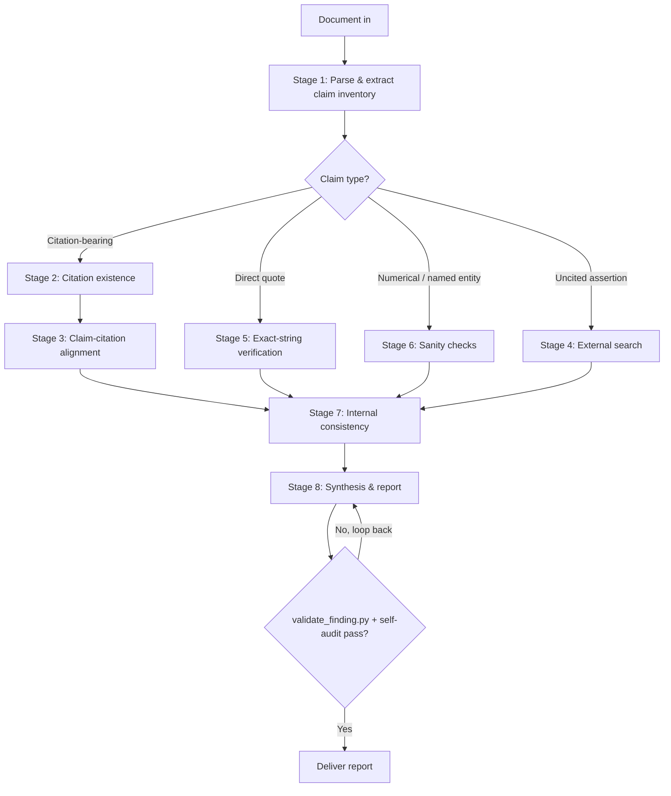

# Research Accuracy Verifier

## Purpose

Verify factual, citation, quotation, and numerical accuracy of LLM-generated research documents — literature reviews, grant text, manuscript drafts, slide decks, reports, white papers, and similar scholarly content. The skill operates as a structured verification pipeline with reproducible evidence trails. Default domain assumption is biomedical / life sciences; the skill also handles general scientific writing.

The goal is a credible, reproducible audit. Most LLM citation errors are subtle (real paper, wrong claim) rather than fully fabricated, and the audit's value collapses if it cries wolf on items it didn't verify.

**Source of truth:** All verdicts, severity assignments, and JSON schemas are defined in [`CONTRACTS.md`](./CONTRACTS.md). This SKILL.md mirrors the contracts for reading convenience; on any disagreement, CONTRACTS.md wins.

## When this skill should NOT trigger

Do not use this skill when the user wants the document edited for style, summarized, expanded with new research, or assessed for novelty / significance. Those are different jobs. If the user asks for any of these *alongside* an accuracy audit, complete the audit first and offer the additional work as a separate next step.

## Initial intake — five questions, asked once

Five questions drive every downstream routing decision. Skipping them produces noticeably worse audits. Ask all five up front in a single consolidated elicitation. Skip any question the user has already answered in prior turns.

The intake answers are emitted as a JSON object validated against [`schemas/intake.json`](./schemas/intake.json):

```jsonc
{
  "document_type":     "grant" | "manuscript" | "lit_review" | "slides" | "report" | "memo" | "other",
  "document_type_other": "string",                                       // required iff document_type == "other"
  "sources_available": "uploaded_files" | "bibliography_only" | "none",
  "verification_tier": "1" | "2" | "3" | "custom",
  "checks_enabled":    ["citation_existence","claim_alignment","uncited_claims",
                        "exact_quotes","numerical_sanity","named_entities","internal_consistency"],
                                                                         // required iff verification_tier == "custom"
  "domain":            "biomedical" | "general" | "mixed",
  "flag_threshold":    "conservative" | "standard" | "strict"
}
```

Tier → `checks_enabled` mapping (computed when tier ≠ `custom`):
- Tier 1 → `["citation_existence"]`
- Tier 2 → `["citation_existence", "claim_alignment"]`
- Tier 3 → all 7 checks

### Required input wrappers

The model **MUST** wrap the document and sources in named XML tags so downstream stages can address them deterministically:

```xml
<intake>
  { ...intake JSON above... }
</intake>

<document>
  ...the full text of the document under review, verbatim...
</document>

<sources>
  <source id="S1" type="pdf"   path="./refs/smith2019.pdf">...optional excerpt or full text...</source>
  <source id="S2" type="doi"   value="10.1038/s41586-020-1234-5"/>
  <source id="S3" type="bib"   path="./refs/library.bib"/>
</sources>
```

`<sources>` is empty `<sources/>` when `sources_available == "none"`.

### Question text (for elicitation)

1. **Document type** — drives parsing strategy and severity weighting:
   `grant` (specific aims, significance, approach) | `manuscript` (intro / results / discussion) | `lit_review` | `slides` | `report` (memo, exec summary) | `memo` | `other` (specify)
2. **Source materials available**: `uploaded_files` (PDFs / .docx / .md / direct paper links) | `bibliography_only` | `none` (external search required for all verification)
3. **Verification tier**: `1` citations only (existence + author/year/journal/DOI) | `2` citations + claim-citation alignment | `3` full (Tier 2 + uncited claims + numbers + quotes + internal consistency + named-entity sanity) | `custom`
4. **Domain**: `biomedical` (PubMed, PMC, bioRxiv, Open Targets, Scite) | `general` (Crossref / OpenAlex first, then web) | `mixed`
5. **Flag threshold**: `conservative` (flag only verified disagreements) | `standard` (disagreement + items that cannot be verified) | `strict` (also flag claims supported by only a single weak source)

## Verification pipeline



### Stage 1 — Document parsing and claim extraction

Build a `ClaimInventory` validated against [`schemas/claim_inventory.json`](./schemas/claim_inventory.json). For each item record `id`, `location {section, paragraph, line}`, `claim_text` (verbatim), `claim_type`, and `citations[]`. Categories:

- **citation_bearing** — any sentence with an inline citation, footnote, or reference marker
- **direct_quote** — text inside quotation marks attributed to a person or source
- **numerical** — percentages, p-values, sample sizes, effect sizes, doses, kinetic parameters (Kd, IC50, EC50), sequence lengths, gene / protein counts, dates
- **named_entity** — gene / protein symbols, drug names (generic and brand), cell lines, antibody clones, mouse strains, instrument models, software versions
- **mechanistic** — causal or mechanistic statements ("X activates Y", "mutation in A causes B")
- **attribution** — "Smith et al. showed…", "the Anderson lab demonstrated…"
- **uncited** — empirical statements with no citation

Build a claim ↔ citation bipartite map: each claim links to zero, one, or many citations; each citation links to all claims it nominally supports.

### Stage 2 — Citation existence verification

For every cited reference, attempt at least two independent identifier paths before assigning a verdict that downgrades the citation. A single failed lookup is not sufficient — APIs fail intermittently and bad metadata can hide a real paper.

**Routing**:
- DOI / PMID / PMCID resolution via PubMed (biomedical) or Crossref / OpenAlex (general)
- If no identifier provided, search by author + year + title fragment + journal
- Verify all metadata fields agree: authors (at least first and last), year, journal, volume, pages, DOI
- For journal-volume-year impossibility (e.g., volume X did not exist in year Y), call `scripts/check_journal_volume.py` (capability key: `verification.citation_existence`)

**Verdict assignments** (canonical — see § Canonical Verdicts):
- record exists, all metadata matches → `VERIFIED`
- record exists, ≥1 field disagrees → `METADATA_MISMATCH`
- no record found via any identifier path → `UNSUPPORTED`
- access blocked (paywall, timeout) → `UNVERIFIED` with `reason`

**Hallucination signatures to look for explicitly** (each becomes evidence for `UNSUPPORTED` after multi-path failure):
- Plausible author names with no matching paper
- Real authors paired with titles they never wrote
- DOIs that don't resolve, or resolve to a different paper
- Journal names that don't exist or are off-by-one ("Nature Cellular Biology" vs. "Nature Cell Biology")
- Year / volume mismatches (volume X did not exist in year Y)
- Page ranges inconsistent with journal volume
- Impossible dates (citation predates the cited finding)

### Stage 3 — Claim-citation alignment

For each claim-citation pair, verify the cited source actually supports the claim attributed to it. This is where most LLM citation errors live: real paper, wrong claim.

**Routing**:
- User-provided source: extract relevant passage; exact-string match for direct quotes (delegate to `scripts/verify_exact_quote.py`); semantic match for paraphrased claims
- No source, abstract available via PubMed: check whether abstract supports, contradicts, or is silent on the claim
- Need full text: attempt PMC fetch; if open access, retrieve and search; if paywalled, assign `UNVERIFIED` with `reason: paywalled_full_text`
- Citation context: query Scite for the cited paper's tally of supporting / contradicting / mentioning citations
- Claim too specific for abstract-only check and full text unavailable: `UNVERIFIED`, **MUST NOT** flag as `CONTRADICTED`

**Verdict assignments** (canonical):
- source clearly supports the claim → `VERIFIED`
- source supports a weaker / narrower version → `OVERGENERALIZED`
- source explicitly contradicts the claim → `CONTRADICTED`
- source does not address the claim → `MISATTRIBUTED`
- access blocked → `UNVERIFIED` with `reason`

**Logic-failure subtypes to detect within Stage 3** — each maps to an existing verdict (no new vocabulary). These distinguish *how to repair* a flagged claim:

- **Correlation presented as causation** — premise cite is correct but claim language asserts causality the source does not support → `OVERGENERALIZED` if a weaker associative version is supported, otherwise `CONTRADICTED`. Recommended action: soften causal language (e.g., "drives" / "causes" → "is associated with").
- **Overgeneralization** — narrow finding extrapolated to a broader population, setting, or time window → `OVERGENERALIZED`.
- **Non-sequitur** — premises true and individually verifiable, but the conclusion does not follow from them → `MISATTRIBUTED` if the cited source is silent on the conclusion, or `UNSUPPORTED` if no source at all connects premises to conclusion.

Cherry-picking — where the cite-claim pair itself is verified but the document selectively suppressed contradicting literature — is **not** a Stage 3 concern (the cited source genuinely supports the claim) and is handled in Stage 4.

### Stage 4 — Uncited claim verification

For substantive uncited claims (depth permitting), search for support.

**Routing**:
- Biomedical: PubMed → bioRxiv (preprints) → Open Targets (target / disease / drug claims) → Consensus (routing aid only) → Scite (citation context) → web
- General scientific: Crossref / OpenAlex → Exa semantic search → web

Capability keys: `verification.citation_existence`, `verification.claim_alignment`. Live MCP tool wiring deferred to v1.3; in v1.2 the LLM performs the search and records the result in `verification_path[]`.

Verdict assignments: same as Stage 3.

**Cherry-picking detection** (Tier 3 only): for already-`VERIFIED` cite-claim pairs from Stage 3, additionally query Scite's citation-context tally for the cited paper. If the supporting/contradicting smart-citation ratio is heavily skewed against the document's framing — i.e., the cited paper supports the narrow claim but a substantial body of literature contradicts the broader position the document is using it to advance — emit a separate finding with verdict `OVERGENERALIZED`. The "claim" being overgeneralized here is the implicit consensus framing, not the narrow cite-claim pair (which remains `VERIFIED` in the matrix). Recommended action: add a contrasting citation or scope-limit the claim.

### Stage 5 — Quotation verification

Direct quotes require exact-string verification. Paraphrase-presented-as-verbatim is a distinct severity from a missing or contradicted quote.

**Procedure** — delegate to `scripts/verify_exact_quote.py` (capability key: `verification.exact_quote`):
- Source provided → exact-string + whitespace-normalized search in source
- No source → web search for the exact phrase in quotation marks
- Verify attribution (right person, right context)
- Verify date / venue if specified

**Verdict assignments** (canonical, only valid when `claim_type == "direct_quote"`):
- exact match → `QUOTE_VERIFIED`
- text differs from source → `QUOTE_PARAPHRASED`
- no matching text in claimed source → `QUOTE_FABRICATED`

### Stage 6 — Numerical and named-entity sanity checks

**Numerical claims** (`scripts/check_journal_volume.py` and number sanity heuristics):
- p-values with implausible precision (≥4 decimal places) or non-standard formatting
- effect sizes outside biologically plausible ranges
- sample sizes inconsistent with described study design or stats
- dates that conflict with cited paper publication years
- **anachronistic temporal claims** — explicit recency phrases ("as of last year", "current data", "recent studies") anchored to a year that no longer qualifies as recent (≥18 months before `date_checked`) → `OVERGENERALIZED` (the claim asserts currency the source does not support). Per matrix, MAJOR for grant / manuscript / lit_review. Recommended action: replace the recency phrase with an explicit cutoff date.
- **anachronistic evidence base** (no specific recency claim, but the latest cited reference year lags `date_checked` by ≥18 months in a fast-moving field) → emit a `header.coverage_caveats[]` entry rather than a `findings[]` entry; this is a coverage gap, not a misstatement. Recommended action: refresh the evidence base or scope-limit the document.

**Named entities** — delegate to `scripts/resolve_entity.py` (which delegates to the `entity-resolution` skill):
- Gene / protein symbols: verify official symbol via HGNC / UniProt; flag aliases that may obscure entity confusion
- Drug names: verify generic ↔ brand correspondence
- Cell lines: cross-check Cellosaurus; flag known misidentified or contaminated lines
- Mouse strains: verify against official Jackson Laboratory or Charles River nomenclature
- Antibody clones: flag claims requiring validation when no clone or RRID is given

Verdict assignments: `VERIFIED | METADATA_MISMATCH | CONTRADICTED | MISATTRIBUTED | UNVERIFIED`.

### Stage 7 — Internal consistency

Cross-check the document against itself. Stage 7 work is largely deterministic and is delegated to scripts:

- `scripts/reconcile_references.py` — bibliography ↔ inline citation set diff (orphan refs, missing inline)
- `scripts/scan_acronyms.py` — acronym defined-before-first-use, expansion drift

The LLM still adjudicates:
- The same fact stated with different numbers in different sections → `CONTRADICTED`
- Discussion claims not supported by results presented → `UNSUPPORTED` or `OVERGENERALIZED`
- Definitions that drift across sections → `METADATA_MISMATCH`
- Author / year mismatches between inline citations and bibliography → `METADATA_MISMATCH`

### Stage 8 — Synthesis and reporting

Assemble the report per `schemas/audit_report.json`. **MUST** call `scripts/validate_finding.py` on every finding before assembling the report; on validation failure, loop back to the offending stage rather than deliver an incomplete report.

Render the markdown report via `scripts/render_report.py` (`generate_report(audit_report_dict) → str`).

## Canonical verdicts

The single vocabulary used by every stage. Defined in [`CONTRACTS.md`](./CONTRACTS.md); reproduced here for reference. Glyphs (✅⚠️❌❓) are no longer used as verdict markers; severity is rendered in the report instead.

| Verdict | Origin | Meaning |
|---|---|---|
| `VERIFIED` | 2 | Citation exists; metadata fields agree |
| `METADATA_MISMATCH` | 2 | Record exists; ≥1 field disagrees |
| `UNSUPPORTED` | 2 / 3 | No identifier path resolves; or source does not contain the claim |
| `OVERGENERALIZED` | 3 | Source supports a weaker / narrower version |
| `CONTRADICTED` | 3 / 7 | Source explicitly contradicts the claim |
| `MISATTRIBUTED` | 3 | Source does not address this claim |
| `QUOTE_VERIFIED` | 5 | Quoted text matches source |
| `QUOTE_PARAPHRASED` | 5 | Paraphrase presented as verbatim |
| `QUOTE_FABRICATED` | 5 | No matching text in claimed source |
| `UNVERIFIED` | any | Could not complete verification; **MUST** include `reason` |

`UNVERIFIED.reason`: `paywalled_full_text | preprint_not_indexed | api_timeout | source_not_provided | tier_does_not_cover | other`

## Severity matrix (Verdict × DocumentType)

Severity is **computed**, not assigned. `validate_finding.py` rejects findings whose `severity` does not match this table.

| Verdict \ DocType | grant | manuscript | lit_review | slides | report | memo | other |
|---|---|---|---|---|---|---|---|
| VERIFIED | INFO | INFO | INFO | INFO | INFO | INFO | INFO |
| METADATA_MISMATCH | MAJOR | MAJOR | MAJOR | MINOR | MINOR | MINOR | MINOR |
| UNSUPPORTED | CRIT | CRIT | CRIT | MAJOR | MAJOR | MINOR | MAJOR |
| OVERGENERALIZED | MAJOR | MAJOR | MAJOR | MAJOR | MINOR | MINOR | MAJOR |
| CONTRADICTED | CRIT | CRIT | CRIT | CRIT | MAJOR | MAJOR | CRIT |
| MISATTRIBUTED | CRIT | CRIT | CRIT | MAJOR | MAJOR | MINOR | MAJOR |
| QUOTE_VERIFIED | INFO | INFO | INFO | INFO | INFO | INFO | INFO |
| QUOTE_PARAPHRASED | MAJOR | MAJOR | MAJOR | MINOR | MINOR | MINOR | MINOR |
| QUOTE_FABRICATED | CRIT | CRIT | CRIT | MAJOR | MAJOR | MAJOR | CRIT |
| UNVERIFIED | INFO | INFO | INFO | INFO | INFO | INFO | INFO |

Cells: `CRIT` = CRITICAL, `MAJOR` = MAJOR, `MINOR` = MINOR, `INFO` = INFORMATIONAL.

**Threshold modifier** (`flag_threshold`):
- `conservative` — emit only findings whose verdict ∈ `{CONTRADICTED, MISATTRIBUTED, UNSUPPORTED, QUOTE_FABRICATED}`; suppress UNVERIFIED from `findings[]` (still in `verification_matrix[]`)
- `standard` (default) — emit per matrix
- `strict` — emit per matrix; promote `METADATA_MISMATCH` and `OVERGENERALIZED` findings with single-source `verification_path` by one severity level

## Operating principles (positive predicates, validator-enforced)

These are not guidelines — they are enforced by `validate_finding.py`. Findings that violate them are rejected, forcing a Stage-8 loop-back.

- **MUST** populate `verification_path[]` with ≥2 distinct entries before assigning `severity == CRITICAL`. (Predicate P2 in CONTRACTS.md.)
- **MUST** include ≥1 `evidence[]` entry with a resolvable URL / PMID / DOI for every finding. (P3.)
- **MUST** use `verdict == UNVERIFIED` with a specific `reason` when verification access is incomplete. (P1.)
- **MUST NOT** emit `severity == CRITICAL` when `verdict == UNVERIFIED`. (P1.)
- **MUST** restrict verdicts ∈ `{QUOTE_VERIFIED, QUOTE_PARAPHRASED, QUOTE_FABRICATED}` to claims with `claim_type == "direct_quote"`. (P4.)
- **MUST** compute `severity` from the matrix in `schemas/severity_matrix.values.json`; user-supplied severities that disagree are rejected. (P5.)
- **MUST** treat Consensus syntheses as routing aids, not primary evidence. Cite the underlying paper, not the synthesis.
- **MUST** quote the original document verbatim when reproducing a claim in the report (so the user can locate the passage); paraphrase external sources per copyright norms.
- **MUST** state coverage gaps prominently in `header.coverage_caveats[]` when full-text access blocks a tier-3 check.

## Output format

Default to markdown for Obsidian compatibility. Render via `scripts/render_report.py` from a JSON object validated against `schemas/audit_report.json`.

The report contains:

### Header

`document_title`, `document_type`, `date_checked`, `verification_tier`, `sources_consulted[]`, `overall_confidence` (`high | moderate | low | very_low`) with one-paragraph `confidence_justification`, and `coverage_caveats[]` called out prominently.

`overall_confidence` is computed:
- `high` — 0 CRITICAL findings, ≤1 MAJOR, no UNVERIFIED beyond depth-tier scope
- `moderate` — ≤2 CRITICAL, or ≤5 MAJOR, or some UNVERIFIED inside scope
- `low` — 3–5 CRITICAL, or pervasive MAJOR, or large UNVERIFIED population
- `very_low` — ≥6 CRITICAL, or evidence of systemic hallucination

### Executive summary

3–5 sentence prose summary covering: total claims checked, count flagged at each severity, the most consequential issues, and an overall recommendation.

Examples:
- "Document is broadly reliable but contains 2 CRITICAL citation errors and 1 MISATTRIBUTED quote that must be corrected before submission."
- "Document contains pervasive citation hallucination (7 of 18 references could not be verified via any identifier path). Recommend rebuilding the bibliography from primary sources."

### Findings, organized by severity

CRITICAL → MAJOR → MINOR → INFORMATIONAL.

For each finding render this table (one per finding):

| Field | Content |
|---|---|
| Location | Section, paragraph (line if available) |
| Claim (verbatim) | Quoted exactly from the document |
| Verification path | Methods + tools (≥1; ≥2 if CRITICAL) |
| Evidence | PMIDs, DOIs, URLs, source quotes |
| Verdict | One of the canonical 10 |
| Severity | Computed from matrix |
| Recommended action | Fix / replace citation / soften claim / verify with full text / etc. |
| Confidence | `high | medium | low` |
| Reason (if UNVERIFIED) | One of the 6 enum values |

#### Worked example — CRITICAL finding

| Field | Content |
|---|---|
| **Location** | Significance, paragraph 3, line 42 |
| **Claim (verbatim)** | "Anti-PD-1 monotherapy in the CT26 syngeneic colon model achieves complete response rates of 47% (Chen et al., 2019, *Nature Cancer* 5:1123–1135)." |
| **Verification path** | (1) `doi_lookup` via Crossref — no DOI provided; (2) `pubmed_search` by author + year + title fragment + journal — 0 hits; (3) `journal_volume_check` (Crossref ISSN 2662-1347) — *Nature Cancer* volume 1 first published Jan 2020, so volume 5 in 2019 is impossible; (4) `pubmed_search` for any Chen et al. paper on CT26 + PD-1 in 2018–2020 — no candidate matches the claimed title or response rate. |
| **Evidence** | *Nature Cancer* journal start year per Crossref ISSN 2662-1347: January 2020. No PubMed / Crossref record matches author/year/title/journal/volume combination. |
| **Verdict** | `UNSUPPORTED` |
| **Severity** | CRITICAL (matrix: UNSUPPORTED × manuscript = CRITICAL) |
| **Recommended action** | Replace with a verified source. Selby et al. 2013 (PMID:23300641) reports CT26 anti-PD-1 response data; or Mosely et al. 2017 (PMID:29097623) for syngeneic-model checkpoint response benchmarks. The 47% number itself is unsupported and **MUST** be re-verified against whichever source is substituted. |
| **Confidence** | high |

#### Optional remediation prompts in `recommended_action`

For findings where the original drafter is still in the loop (e.g., the user is iterating with an LLM), `recommended_action` MAY suffix one stress-test prompt the user can send back to the drafter. These are author-facing suggestions, not validator-enforced text:

- `CONTRADICTED` → Re-prompt the drafter: *Using the same source, argue the opposite conclusion. If you can construct an equally strong argument, this claim needs revision.*
- `OVERGENERALIZED` → Re-prompt the drafter: *What evidence would need to exist for this conclusion to be false? List the specific assumptions you've made.*
- Cherry-picking flagged in Stage 4 → Re-prompt the drafter: *Give me the strongest counterargument before I accept this — including any contradicting studies you may have omitted.*

These prompts are useful when the document is still in active drafting; omit them when auditing a frozen submission.

### Verification matrix (appendix)

A complete table mapping every claim → verification source(s) → verdict, including unflagged items, so the user has a full audit trail.

### Methodology note

Brief description of which sources were queried in what order, depth tier executed, and any limitations.

## Connector and tool priority

In priority order, for biomedical documents (capability keys in `skills/shared/tool-lookup.yaml`):

1. **PubMed MCP** (`verification.citation_existence` primary) — citation existence, abstract retrieval, related articles
2. **User-provided source materials** — ground truth
3. **bioRxiv MCP** — preprint coverage
4. **Open Targets MCP** — target / disease / drug claims
5. **Crossref / OpenAlex** via web fetch (`verification.citation_existence` fallback) — DOI resolution and metadata
6. **PMC** via web fetch (`verification.claim_alignment` primary) — open-access full text for alignment
7. **Consensus MCP** — claim-level synthesis as routing aid only
8. **Scite** via web (`verification.claim_alignment` fallback) — citation context
9. **Exa** via web — semantic search when keyword search fails
10. **Web search** (`verification.exact_quote` primary) — fallback for everything else; primary path for exact-quote verification
11. **`entity-resolution` skill** (`verification.entity_sanity` delegate) — gene / drug / disease ID resolution

For general scientific documents, lead with Crossref / OpenAlex; use PubMed only when the topic crosses into life sciences.

## Special domain handling — Oligon / aptamer-siRNA / immuno-oncology

When document content concerns aptamer-siRNA chimera biology, T-cell exhaustion, immune checkpoint biology, or oncology preclinical models, apply additional domain-specific checks:

- **Aptamer claims**: length, modifications (2′-F, 2′-OMe, LNA, PS backbone), chemistry are accurately described and consistent with cited source
- **siRNA design**: strand polarity (sense / antisense / guide / passenger usage), modification chemistry, IC50 reporting conventions, off-target predictions
- **Cell-line provenance**: ATCC / JCRB / DSMZ IDs where relevant; flag known misidentified lines
- **Mouse model nomenclature**: official Jackson / Charles River strain designations; verify syngeneic model–host strain compatibility (CT26 / BALB-c, MC38 / C57BL-6, B16 / C57BL-6, 4T1 / BALB-c, ID8 / C57BL-6)
- **Statistical tests**: appropriateness for described data type (parametric vs. non-parametric, paired vs. unpaired, multiple-comparison correction)
- **Antibody / clone identifiers**: RRIDs preferred; flag claims requiring validation when no clone is named

## Self-audit (automated, runs in Stage 8)

Before delivering the report, `scripts/validate_finding.py --batch findings.json` **MUST** pass. The validator enforces:

1. Every finding satisfies P1–P5 (see CONTRACTS.md).
2. Every claim in the inventory appears in either `findings[]` or `verification_matrix[]`.
3. Severity is consistent with the matrix.
4. Original document wording is preserved exactly when quoted (string equality against `<document>` content).
5. Coverage caveats are populated whenever a tier-3 check was requested but blocked.

Validator failure forces Stage-8 loop-back. The skill **MUST NOT** deliver a report whose findings have not passed the validator.

## Background reading

The following references in `references/` provide non-technical conceptual grounding for the verification frameworks operationalized by this skill. They are useful for understanding *why* the pipeline is structured the way it is, but the skill itself never reads them at runtime — they are for human reference only.

- `Fact-Checking AI - How to spot Errors and Reduce Hallucinations.md` — full course transcript (Birss, Gen AI Academy, 2026); covers the three error flavors (phantom statistic, dead citation, reasoning error in true data), six pre-verification red flags, four logic-failure types, and a three-step verification workflow (risk triage → verify by type → second opinion)
- `Fact-Check AI - Course Workbook.pdf` — pocket-reference summary of the same frameworks

What this skill **does** implement from Birss's frameworks: three-error-flavor detection (Stage 2), verify-by-type ordering (Stages 2 → 3 → 6), risk triage (verification_tier × flag_threshold × severity matrix), and the four logic-failure subtypes (Stages 3 and 4).

What this skill **does not** implement: pre-verification red-flag triage (no Stage 1 priority signals; deferred), second-LLM critique as a workflow step (the existing Stage 8 self-audit is schema validation via `validate_finding.py`, not a second-model critique), and Birss's "six honesty prompts" / "autonomy ladder" — these target document drafting and agent-action governance, which are separate concerns from post-hoc document audit (this skill's sole responsibility — see `## Out of scope`).

## Out of scope

- Editing the document for style, grammar, or clarity
- Adding new research or expanding sections
- Producing a literature review on the document's topic
- Judging the scientific novelty or significance of claims (only their accuracy)
- Reproducing computational analyses or re-running statistics
- HTML / docx / annotated-PDF output (markdown only in v1.2; HTML via oligon-brand deferred to v1.3)

If the user asks for any of these alongside accuracy checking, complete the audit first and offer the additional work as a separate next step.
