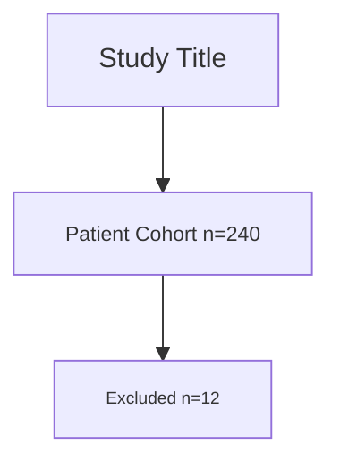

# Scientific Schematics and Diagrams

> **Design Foundation**: This skill extends [`visual-design`](../visual-design/SKILL.md) for typography, color, composition, and accessibility standards. Cognitive-foundation citations (Cleveland-McGill 1984, Wagemans 2012 Gestalt grouping, Crameri 2020, Fujii 2026 communication context) and cross-skill quality gates also live in [`oligon-brand`](../oligon-brand/SKILL.md) `<design_foundation>` and [`shared/references/`](../shared/references/) (`pre_submission_checklist.md`, `communication_context_matrix.md`, `figure_vs_table_decision.md`).

> **Quantified Thresholds:** This skill references shared thresholds from [`QUANTIFICATION_THRESHOLDS.md`](../QUANTIFICATION_THRESHOLDS.md) §7 (Quality Rubrics) and §8 (Iteration & Stopping Criteria).

<overview>
Generate publication-quality scientific diagrams using a tiered approach that optimizes for cost and speed. **Tier 1 (Mermaid)** handles simple diagrams for free with instant local rendering. **Tier 2 (AI)** uses Nano Banana Pro for complex diagrams with Gemini 3 Flash/Pro quality review. The complexity analyzer automatically routes requests to the appropriate tier based on diagram type, node count, and quality requirements. For AI generation, smart iteration stops early when quality score ≥ document threshold (6.5-8.5/10).
</overview>

<when_to_use>
## Trigger Conditions

Use this skill when:
- Creating neural network architecture diagrams (Transformers, CNNs, RNNs)
- Designing methodology flowcharts (CONSORT, PRISMA, study design)
- Illustrating biological pathways and molecular interactions
- Generating system architecture and data flow diagrams
- Drawing circuit diagrams and electrical schematics
- Creating algorithm workflows and processing pipelines
- Designing conceptual frameworks and theoretical models

Do NOT use this skill when:
- Creating data visualizations (plots, charts) → use `plotting-libraries`
- Generating photorealistic images → use `generate-image`
- Graphical abstracts or visual summaries from paper text → use `paperbanana`
- Designing slides or posters → use `scientific-slides`, `research-posters`
- Need design philosophy guidance → use `visual-design`
</when_to_use>

<prerequisites>
## Prerequisites

| Dependency | Version | Purpose | Required For |
|------------|---------|---------|--------------|
| Python | ≥3.9 | Runtime environment | All |
| requests | any | HTTP API calls to OpenRouter | Tier 2 (AI) |
| OPENROUTER_API_KEY | required | Environment variable for API authentication | Tier 2 (AI) |
| mermaid-cli (mmdc) | ≥10.0 | Mermaid diagram rendering | Tier 1 (Mermaid) |

**Installation:**
```bash
# Install Python dependency (for AI generation)
pip install requests

# Set API key (get from https://openrouter.ai/keys) - only needed for Tier 2
export OPENROUTER_API_KEY='sk-or-v1-your_key_here'

# Install mermaid-cli for Tier 1 rendering (requires Node.js)
npm install -g @mermaid-js/mermaid-cli

# Or use Python fallback (limited features)
pip install mermaid-py
```

**Verification:**
```bash
# Verify full setup
python {baseDir}/scripts/generate_schematic.py --help

# Verify Mermaid CLI (for Tier 1)
mmdc --version
```

> **Note:** Tier 1 (Mermaid) works without an API key. Only Tier 2 (AI) requires OPENROUTER_API_KEY.
</prerequisites>

<brand_application>
## Brand Application (Default)

**By default, all scientific diagrams use Oligon Scientific Brand colors.** Include brand color guidance in generation prompts.

### Default Colors for Prompts

When generating diagrams, include these colors in the prompt:

```
Primary elements: #2DB2E8 (Brand Blue) - highlights, key components
Contrast/alerts: #E8622D (Orange) - warnings, opposing elements
Text/labels: #222222 (Dark Gray) - primary text, control elements
Secondary elements: #666666 (Medium Gray) - supporting components
Background: #FFFFFF (White) - clean background
```

**Example prompt with brand colors:**
```
CONSORT flowchart with Oligon brand colors:
- Process boxes: white fill, #222222 borders
- Randomization node: #2DB2E8 (Brand Blue) fill
- Exclusion boxes: #E8622D (Orange) accent
- Text: #222222
- Background: white
```

### Mermaid Brand Theme (SVG output)

When emitting SVG via Mermaid, the default theme uses Trebuchet MS at ~14–16px — both the font family and (effectively) the smallest sizes violate brand standards. **Every Mermaid block must declare `themeVariables` in an init directive** to enforce Arial + the brand size ladder (v2.3 figure scale: title 12pt, axis 10pt, tick 9pt, legend 8.5–9pt — see the SVG output contract in `../oligon-brand/SKILL.md`).

Paste this block at the top of every Mermaid source:

```mermaid
%%{init: {
  'theme': 'base',
  'themeVariables': {
    'fontFamily': 'Arial, Helvetica, sans-serif',
    'fontSize': '12px',
    'primaryColor': '#FFFFFF',
    'primaryBorderColor': '#222222',
    'primaryTextColor': '#222222',
    'lineColor': '#222222',
    'secondaryColor': '#2DB2E8',
    'tertiaryColor': '#E8622D',
    'background': '#FFFFFF',
    'titleColor': '#222222'
  }
} }%%
flowchart TD
  ...
```



Mermaid's `fontSize` is a single value applied as the base; node/edge/title sizes are derived multiplicatively. To pin specific text elements at 9pt, 10pt, or 12pt, define classes with Mermaid's `classDef` and apply them per-node with `:::`:



Note the `:::class` syntax after each node — Mermaid won't apply `classDef` rules to nodes that aren't tagged.

**Post-render verification (required for every SVG emission):**

Step 1 — text-level brand compliance via grep:
```bash
grep -oE 'font-family[^;">]+' figure.svg | sort -u
# Expected: only Arial / Helvetica / sans-serif variants
grep -oE 'font-size[^;">]+' figure.svg | sort -u
# Expected: values in {10, 12, 14, 16} px or pt
```

Step 2 — visual layout check via PNG preview (catches problems grep can't see — overlap, clipping, weird proportions in Mermaid auto-layout):
```bash
../oligon-brand/scripts/render_svg_preview.sh figure.svg
# Then Read the resulting figure.preview.png and confirm: no clipped labels,
# no node overlap, arrowheads land correctly, legend/title placement sane.
```
See `../oligon-brand/SKILL.md` `<svg_output>` § Visual Preview for the full delivery checklist. Mermaid's auto-layout is especially prone to overlap when node text is long — the preview step catches this before delivery.

If Mermaid renders with system defaults despite the init block (some renderers strip `%%{init}%%`), pass the same themeVariables via the Mermaid CLI `-c config.json` flag or render through `mmdc --configFile`. Do not deliver an SVG that fails the grep checks.

For AI-generated SVG (Nano Banana Pro path), the model cannot be relied upon to emit explicit `font-family` and `font-size` attributes per element. After generation, post-process with a small SVG-walker (or Inkscape's `--actions=select-all;object-set-attribute:font-family,Arial`) to inject the brand attributes — or regenerate with the explicit attribute requirement in the prompt.

### Biological Color Conventions (When Brand Styling Is Disabled)

When generating mechanism, pathway, or structural diagrams without Oligon brand colors, biologists expect the following conventional color assignments. Use these in prompts to match reader mental models — inconsistency with convention forces reviewers to relearn the legend.

| Entity | Conventional color | Notes |
|--------|-------------------|-------|
| DNA (double helix) | Blue / navy or neutral gray | Use single hue per strand |
| mRNA / RNA | Orange or yellow | Distinguish from DNA |
| Protein | Varies — assign one color per protein family and reuse across all figures in the paper | Consistency across figures > arbitrary palette per figure |
| Cell nucleus | Light gray or pale blue fill | Subordinate to nuclear contents |
| Cell membrane / lipid bilayer | Tan / beige | Two parallel lines or filled band |
| Mitochondria | Orange | |
| Lysosomes | Red / purple | |
| Endoplasmic reticulum | Light green | |
| Golgi apparatus | Pink / magenta | |

**Signal-direction convention** (independent of color) — path, terminator, stroke width, and profile are four separately declared channels:
- Activation: → (solid line, solid arrowhead)
- Inhibition: ⊣ (solid line, flat bar terminator)
- Indirect / hypothetical / context-dependent: - - → (dashed line, solid arrowhead) — the canonical meaning of dashed in mechanism and pathway diagrams. Dashed as a categorical series identifier stays legal in data plots; any other dashed use (cut plane, weak signal, cross-attention, secondary flow) must be legend-declared and must not co-occur with the canonical use in the same figure
- Feedback regulation: ↺ curved return path routed clear of the forward flow, terminator carrying the sign (arrowhead = positive feedback, flat bar = negative feedback)
- Label leader: —● thin line ending in a filled dot, **never** an arrowhead. An arrowhead implies movement, so readers keep searching for where it leads instead of treating the label as a stopping point; a dot gives a clean endpoint
- Reversible reaction / equilibrium: ⇌ two opposing half-arrows
- Catalysis / enzyme action on substrate: ⊳ solid line, open arrowhead
- Named reaction or process: → with the enzyme / kinase / process name set above the arrow. This is the **single sanctioned exception** to caption-only arrow labelling — the name must *be* the relationship (e.g. "phosphorylation"), never a restatement of what the arrowhead already encodes (e.g. "activation")
- Motion / flow: tapered or fading stroke, legend-declared; magnitude never rides on the taper
- Stroke width: ordinal magnitude across instances of one relationship, legend-declared only — ordinal comparison, never value-reading
- Optional color overlay: green = activating, red = inhibiting, gray = neutral/context — **never** the only cue (see the Canonical Arrow Legend in `references/best_practices.md`).

### Disabling Brand Styling

To use generic/accessibility-focused styling instead of Oligon brand:

**Explicit request in prompt:**
- "Use Okabe-Ito palette" or "Use accessibility colors"
- "No brand colors" or "Generic color scheme"

**Per-project override:** Add to project `CLAUDE.md`:
```markdown
## Visual Styling
Use generic/default styling for all visual outputs. Do not apply Oligon brand.
```

</brand_application>

<decision_framework>
## Decision Matrix

### Schematic Type Selection

```
What do you need to visualize?
│
├─ Study Design / Methodology
│  │
│  ├─ Clinical trial participant flow → CONSORT flowchart
│  │
│  ├─ Systematic review article flow → PRISMA flowchart
│  │
│  ├─ General experimental procedure → Methods flowchart
│  │
│  └─ Data processing pipeline → Pipeline diagram
│
├─ Machine Learning / AI
│  │
│  ├─ Attention-based model → Transformer architecture
│  │
│  ├─ Image processing model → CNN architecture
│  │
│  ├─ Sequential data model → RNN/LSTM architecture
│  │
│  └─ General neural network → Block diagram with layers
│
├─ Biological Systems
│  │
│  ├─ Signal transduction → Pathway diagram (MAPK, PI3K, etc.)
│  │
│  ├─ Metabolic process → Metabolic pathway
│  │
│  ├─ Gene regulation → Regulatory network
│  │
│  └─ Protein interactions → Interaction network
│
├─ Systems / Engineering
│  │
│  ├─ Software components → System architecture
│  │
│  ├─ Hardware connections → Block diagram
│  │
│  ├─ Data flow → Data flow diagram
│  │
│  └─ Electronic circuit → Circuit schematic
│
└─ Abstract Concepts
   │
   ├─ Theoretical framework → Conceptual diagram
   │
   ├─ Classification system → Hierarchy diagram
   │
   └─ Process overview → Block diagram
```

### Quality Threshold by Document Type

> Reference: [`QUANTIFICATION_THRESHOLDS.md`](../QUANTIFICATION_THRESHOLDS.md) §8

| Document Type | Threshold | Soft Limit | Hard Limit | Use Case |
|---------------|-----------|------------|------------|----------|
| journal | 8.5/10 | 3 | 5 | Nature, Science, peer-reviewed journals |
| conference | 8.0/10 | 3 | 5 | Conference papers |
| thesis | 8.0/10 | 3 | 5 | Dissertations, theses |
| grant | 8.0/10 | 3 | 5 | Grant proposals |
| preprint | 7.5/10 | 2 | 4 | arXiv, bioRxiv preprints |
| report | 7.5/10 | 2 | 4 | Technical reports |
| poster | 7.0/10 | 2 | 3 | Academic posters |
| presentation | 6.5/10 | 2 | 3 | Slides, talks |
| default | 7.5/10 | 3 | 5 | General purpose |

**Iteration Behavior:**
- **Soft limit:** Target iterations; stop if quality ≥ threshold OR soft limit reached
- **Hard limit:** Absolute maximum; never exceed regardless of quality score

### Tool Selection Matrix

| Diagram Type | Tier 1 (Simple) | Tier 2 (Complex) | Export Format |
|--------------|-----------------|------------------|---------------|
| Flowcharts (CONSORT, PRISMA) | Mermaid | Nano Banana Pro | PNG, SVG, PDF |
| Sequence Diagrams | Mermaid | Nano Banana Pro | PNG, SVG |
| State Machines | Mermaid | Nano Banana Pro | PNG, SVG |
| Class Diagrams | Mermaid | Nano Banana Pro | PNG, SVG |
| Neural Network Architecture | — | Nano Banana Pro | PNG, SVG |
| Biological Pathways | — | Nano Banana Pro | PNG, PDF |
| Circuit Diagrams | — | Nano Banana Pro | PNG, PDF |
| System Architecture | Mermaid | Nano Banana Pro | PNG, SVG |
| Block Diagrams | Mermaid | Nano Banana Pro | PNG, SVG |
| Gantt Charts | Mermaid | — | PNG, SVG |
| ER Diagrams | Mermaid | Nano Banana Pro | PNG, SVG |

</decision_framework>

<generation_tiers>
## Generation Tiers

This skill uses a tiered approach to optimize cost and speed:

### Tier 1: Mermaid (Free, Instant)

**Best for:**
- Simple flowcharts (<10 nodes)
- Basic sequence diagrams
- State machines
- CONSORT/PRISMA (simple versions)
- Draft/internal documents

**Characteristics:**
- Cost: $0 (local rendering)
- Speed: ~100ms
- Output: Deterministic (same input = same output)
- Quality: Good for presentations, drafts

**Limitations:**
- No custom positioning
- Limited styling options
- No domain-specific rendering (pathways, neural networks)

### Tier 2: AI Generation (Publication Quality)

**Best for:**
- Complex diagrams (≥10 nodes)
- Neural network architectures
- Biological pathways
- Publication-quality figures
- Custom branding/styling

**Characteristics:**
- Cost: ~$0.02-0.05 per generation
- Speed: 10-30 seconds
- Output: Variable (AI creativity)
- Quality: Publication-ready

### Tier Selection

```bash
# Auto-select based on complexity (default)
python {baseDir}/scripts/generate_schematic.py "prompt" -o output.png

# Force Mermaid (skip AI)
python {baseDir}/scripts/generate_schematic.py "prompt" -o output.png --engine mermaid

# Force AI generation
python {baseDir}/scripts/generate_schematic.py "prompt" -o output.png --engine ai

# Analyze complexity without generating (dry run)
python {baseDir}/scripts/generate_schematic.py "prompt" -o output.png --analyze
```

### Tier Decision Matrix

| Condition | Recommended Tier |
|-----------|------------------|
| <10 nodes, draft/presentation | Mermaid |
| <10 nodes, publication | AI |
| ≥10 nodes | AI |
| Neural network | AI |
| Biological pathway | AI |
| Custom branding | AI |
| CONSORT/PRISMA (simple) | Mermaid |
| CONSORT/PRISMA (detailed) | AI |
| Sequence diagram | Mermaid |
| State machine | Mermaid |
| Class diagram | Mermaid |

### Automatic Engine Selection

When `--engine auto` (default), the complexity analyzer evaluates:

1. **Diagram type detection** - Identifies type from keywords (flowchart, sequence, state, neural network, pathway)
2. **Complexity estimation** - Counts nodes, edges, and hierarchy levels from prompt
3. **Quality requirements** - Checks document type threshold (journal=8.5, presentation=6.5)
4. **Mermaid compatibility** - Verifies diagram type is supported by Mermaid

The analyzer outputs a recommendation with confidence score and reasoning.

</generation_tiers>

<data_driven_diagrams>
## Data-Driven Diagrams

**When the diagram subject involves a specific gene, protein, drug, or pathway**, query real biological data from ToolUniverse before constructing the diagram prompt. This produces diagrams with verified components rather than hallucinated topology.

**Pattern:** Query data → Extract diagram elements → Feed into prompt → Generate with verified components.

### Supported Data-Fed Diagram Types

| Diagram Type | Data Source (tool-lookup.yaml key) | What Data Provides |
|--------------|------------------------------------|--------------------|
| Pathway diagram | `interactions.pathways` (Reactome/KEGG) | Verified pathway steps, enzyme names, metabolite flow |
| PPI network | `visualization_data.ppi_network` (STRING) | Confidence-scored edges, node list, cluster structure |
| Domain architecture | `target_structure.domains` (InterPro/Pfam) | Domain boundaries, families, functional annotations |
| Expression profile | `visualization_data.expression_heatmap` (GTEx) | Tissue names, TPM values for relative sizing |
| Variant landscape | `visualization_data.variant_frequency` (gnomAD) | Variant positions, frequencies, constraint regions |

### Modified Workflow for Data-Fed Diagrams

**Stage 1 addition:** Before listing components, query the relevant database to get real data. Use capability keys from `tool-lookup.yaml` — never hardcode tool names.

**Stage 3 addition:** Incorporate queried data into the prompt. Example data-fed prompt:

```
PPI network diagram for TP53.
Layout: force-directed, circular for core interactors.

Verified interactors from STRING (score ≥ 700):
- TP53 ↔ MDM2 (score: 999, inhibition)
- TP53 ↔ CDKN1A (score: 998, activation)
- TP53 ↔ BAX (score: 990, activation)
- [... additional edges from query ...]

Edge thickness proportional to STRING confidence score.
Node color by functional category (apoptosis=blue, cell cycle=green, DNA repair=orange).
Colorblind-friendly palette. Label all nodes with gene symbols.
```

### When NOT to Use Data-Fed Diagrams

- **Conceptual/theoretical diagrams** — no specific gene/protein to query
- **Generic methodology flowcharts** — CONSORT, PRISMA templates don't need live data
- **Diagrams of hypothetical mechanisms** — use standard prompt construction
- **Diagram subjects not in databases** — novel proteins, non-model organisms

**Dossier-first principle:** If an upstream target-intelligence or drug-intelligence dossier exists, extract diagram data from it rather than re-querying ToolUniverse.

</data_driven_diagrams>

<workflow>
## Workflow

### Stage 1: Requirements Analysis

**Objective:** Understand diagram requirements and constraints

**Steps:**
1. Identify diagram type from decision matrix
2. Determine document type for quality threshold
3. List all components to include
4. Define flow direction (top-to-bottom, left-to-right)
5. Identify labeling requirements

**Exit Criteria:**
- [ ] Diagram type identified (flowchart, architecture, pathway, etc.)
- [ ] Document type selected (journal, poster, presentation, etc.)
- [ ] Component list complete (≥3 elements for meaningful diagram)
- [ ] Flow direction specified
- [ ] Key labels documented

---

### Stage 2: Tier Selection

**Objective:** Route to appropriate generation engine

**Steps:**
1. Run complexity analysis (automatic or manual)
2. Review tier recommendation and reasoning
3. Override if needed based on specific requirements

**Decision Flow:**
```
Is diagram type Mermaid-compatible?
│
├─ NO → Tier 2 (AI generation)
│
└─ YES → Check complexity
         │
         ├─ <10 nodes AND draft/presentation → Tier 1 (Mermaid)
         │
         └─ ≥10 nodes OR publication quality → Tier 2 (AI generation)
```

**Command (optional analysis):**
```bash
python {baseDir}/scripts/generate_schematic.py "prompt" -o output.png --analyze
```

**Exit Criteria:**
- [ ] Tier selected (Mermaid or AI)
- [ ] If overriding auto-selection, documented reason

---

### Stage 3: Prompt Construction

**Objective:** Create effective prompt for generation (applies to both tiers)

**Steps:**
1. Start with diagram type and layout specification
2. Add specific components with relationships
3. Include quantitative details (node counts, dimensions)
4. Specify visual style preferences
5. Add accessibility requirements (colorblind-safe)

**Exit Criteria:**
- [ ] Prompt specifies diagram type explicitly
- [ ] All components listed with connections
- [ ] Flow direction stated
- [ ] Label requirements included
- [ ] Prompt length 50-200 words (optimal range)

**Prompt Template:**
```
{{DIAGRAM_TYPE}} diagram showing {{MAIN_SUBJECT}}.

Layout: {{FLOW_DIRECTION}} (top-to-bottom/left-to-right/circular)

Components:
- {{Component 1}} connected to {{Component 2}} via {{relationship}}
- {{Component 3}} with label "{{label text}}"
- ...

Quantitative details: {{specific numbers, dimensions, counts}}

Visual style: {{style preferences}}
- Colorblind-friendly palette
- Clear labels (minimum 10pt)
- Professional typography
```

---

### Stage 4: Generation

**Objective:** Generate diagram (Mermaid or AI based on tier selection)

**Steps (Tier 1 - Mermaid):**
1. Convert prompt to Mermaid syntax (automatic)
2. Render diagram using mermaid-cli
3. Output PNG/SVG to specified path

**Steps (Tier 2 - AI):**
1. Set OPENROUTER_API_KEY environment variable
2. Execute generation script with document type
3. Nano Banana Pro generates initial image
4. Gemini 3 Flash (or Pro) reviews quality against threshold
5. If quality < threshold AND iterations < max, improve and regenerate

**Exit Criteria:**
- [ ] Generation completed without errors
- [ ] For Tier 2: Quality score ≥ document type threshold
- [ ] Image saved to figures/ directory
- [ ] For Tier 2: Review log saved as JSON

**Commands:**
```bash
# Auto-select tier (recommended)
python {baseDir}/scripts/generate_schematic.py "{{prompt}}" \
  -o figures/{{output_name}}.png \
  --doc-type {{document_type}} \
  -v

# Force Mermaid (Tier 1) - free, instant
python {baseDir}/scripts/generate_schematic.py "{{prompt}}" \
  -o figures/{{output_name}}.png \
  --engine mermaid

# Force AI (Tier 2) - publication quality
python {baseDir}/scripts/generate_schematic.py "{{prompt}}" \
  -o figures/{{output_name}}.png \
  --engine ai \
  --doc-type {{document_type}} \
  --iterations 2 \
  -v

# For high-stakes AI work, use Pro review:
# --review-model pro
```

**Smart Iteration Logic:**
```
Generate Image → Review Quality → Score >= Threshold?
                                        │
                                        ├─ YES → DONE (early stop)
                                        │
                                        └─ NO → Iteration < Hard Limit?
                                                     │
                                                     ├─ NO → DONE (hard limit reached)
                                                     │
                                                     └─ YES → Iteration < Soft Limit?
                                                                   │
                                                                   ├─ YES → Improve prompt, regenerate
                                                                   │
                                                                   └─ NO → Score improving? (Δ ≥ 0.5)
                                                                                │
                                                                                ├─ YES → Continue to hard limit
                                                                                │
                                                                                └─ NO → DONE (diminishing returns)
```

**Stopping Criteria** (from §8):

| Stop When | Reason |
|-----------|--------|
| Quality score ≥ threshold | Target achieved |
| Soft limit reached AND score not improving | Diminishing returns |
| Hard limit reached | Absolute maximum |
| Score improvement < 0.5 between iterations | Plateau detected |
| Critical error in generation | Cannot proceed |

---

### Stage 5: Quality Verification

**Objective:** Verify diagram meets publication standards (primarily for Tier 2)

**Steps:**
1. Review quality assessment from Gemini 3 Flash/Pro
2. Check 5 quality dimensions (see scoring rubric)
3. Verify accessibility (colorblind-safe, contrast)
4. Confirm all labels readable at final size
5. Validate file format and resolution
6. **Anti-slop check (post-generation).** For Tier-1 Mermaid SVG: run `uv run python ../svg-figure-maker/scripts/preflight_check.py figure.svg` — its anti-slop checks flag garbled `<text>` (`check_garbled_text`, which emits the `categorical` severity), default-library palette fingerprint (`check_default_palette_fingerprint`), and raw-index node labels (`check_raw_index_labels`) — exact, against the labels and palette we authored (no OCR). A `categorical`-severity finding is a hard fail. For Tier-2 AI (Nano Banana Pro) raster output: there is no source SVG to diff, so do a structured human-eye Class-A categorical check against the `../shared/references/generative_artifact_tells.md` rubric — confirm every label is a real word/term (no `diƨlocttal`-style glyph-strings), every arrow connects meaningful entities (no arrows to/from nothing), anatomy/topology is valid, and printed numbers/units are plausible. These categorical tells dominate the verdict; the default-palette / decoration signal is weak, two-sided, and must not by itself fail a diagram (Bateman CHI 2010 — never strip decoration or minimize ink to clear it). Emit findings as a vector of severity-tagged sub-scores, never a single slop score; thresholds are provisional/uncalibrated. Full doctrine: `../shared/references/ai_figure_slop.md`.

**Exit Criteria:**
- [ ] Overall quality score ≥ threshold for document type
- [ ] No high-severity issues in quality report
- [ ] Colorblind simulation passes
- [ ] Text readable at target reproduction size
- [ ] File format appropriate (PNG for web, PDF for print)
- [ ] Anti-slop: SVG output has zero `categorical`-severity findings from `preflight_check.py`; for AI raster output, no lexically-void labels, no arrows to/from nothing, no impossible anatomy/topology (human-eye Class-A check per `../shared/references/generative_artifact_tells.md` / `ai_figure_slop.md`)

**Quality Scoring Rubric (10 points total):**

> Reference: [`QUANTIFICATION_THRESHOLDS.md`](../QUANTIFICATION_THRESHOLDS.md) §7 (Schematic Quality Rubric)

| Dimension | Points | 0 (Fail) | 1 (Acceptable) | 2 (Excellent) |
|-----------|--------|----------|----------------|---------------|
| Scientific Accuracy | 0-2 | Factual errors | Minor issues | Scientifically accurate |
| Clarity & Readability | 0-2 | Confusing layout | Understandable | Intuitive flow |
| Label Quality | 0-2 | Missing/unreadable | Present but issues | Clear, consistent |
| Layout & Composition | 0-2 | Overlaps/cramped | Reasonable spacing | Balanced, logical |
| Professional Appearance | 0-2 | Amateur look | Acceptable | Publication-ready |

**Score Interpretation:**
- 0-4: Needs revision (below all thresholds)
- 5-6: Acceptable for presentations/posters
- 7-8: Acceptable for preprints/reports
- 9-10: Publication-ready (journal quality)

---

### Stage 6: Integration

**Objective:** Integrate diagram into manuscript/presentation

**Steps:**
1. Move final image to appropriate figures/ directory
2. Add to LaTeX with `\includegraphics{}`
3. Write comprehensive figure caption
4. Add cross-reference in main text
5. Verify consistent styling with other figures

**Exit Criteria:**
- [ ] Image in correct directory
- [ ] Caption describes all diagram elements
- [ ] Abbreviations defined in caption
- [ ] Figure referenced in text (e.g., "Figure 1 shows...")
- [ ] Style consistent with other manuscript figures

</workflow>

<success_criteria>
## Success Criteria

**Quantitative Thresholds:**

| Metric | Minimum | Target | Excellent |
|--------|---------|--------|-----------|
| Quality score (journal) | 8.0/10 | 8.5/10 | 9.5/10 |
| Quality score (poster) | 6.5/10 | 7.0/10 | 8.0/10 |
| Iteration efficiency | 2 iterations | 1 iteration | 1 iteration |
| Label readability | 8pt at final | 10pt at final | 12pt at final |
| Resolution | 150 DPI | 300 DPI | 600 DPI |

**Completion Checklist:**
- [ ] Diagram type matches content requirements
- [ ] Quality score meets document type threshold
- [ ] All components present and labeled
- [ ] Colorblind-accessible palette used
- [ ] No overlapping elements
- [ ] Professional, consistent styling
- [ ] Appropriate file format for venue

</success_criteria>

<scope>
## Scope

**In Scope:**
- AI-generated scientific diagrams via Nano Banana Pro
- Quality review via Gemini 3 Flash (default) or Pro
- CONSORT/PRISMA flowcharts
- Neural network architecture diagrams
- Biological pathway illustrations
- System architecture diagrams
- Circuit schematics
- Conceptual frameworks

**Out of Scope** (use specialized resources):
- Data visualizations (plots, charts) → use `plotting-libraries`
- Photorealistic image generation → use `generate-image`
- Slide design → use `scientific-slides`
- Poster layout → use `research-posters`
- Design principles → use `visual-design`
- Hand-drawn or sketch-style diagrams → external tools

</scope>

<anti_patterns>
## Common Pitfalls

### 1. Vague Prompts

**Anti-pattern:**
```
"Make a flowchart"
"Neural network diagram"
"Pathway illustration"
```

**Solution:**
```
"CONSORT participant flow diagram with 500 screened,
150 excluded (80 age<18, 50 declined, 20 other),
350 randomized into treatment (n=175) and control (n=175) arms.
Show lost to follow-up (15 treatment, 10 control) and final
analyzed (160 treatment, 165 control). Top-to-bottom layout."
```

---

### 2. Missing Component Details

**Anti-pattern:**
```
"Transformer architecture"
```

**Solution:**
```
"Transformer encoder-decoder architecture.
Left: Encoder with input embedding, positional encoding,
multi-head self-attention (8 heads), add & norm, feed-forward, add & norm.
Right: Decoder with output embedding, positional encoding, masked self-attention,
cross-attention from encoder, add & norm, feed-forward, linear & softmax.
Show cross-attention connection with dashed line, and add a legend entry
reading 'dashed = cross-attention' — a legend-declared use, legal here because
this diagram contains no indirect/hypothetical edges."
```

---

### 3. Wrong Quality Threshold

**Anti-pattern:**
Using journal-quality threshold (8.5) for a quick internal presentation, wasting API calls on unnecessary refinement.

**Solution:**
Match document type to use case:
- `--doc-type presentation` for slides (6.5 threshold)
- `--doc-type poster` for posters (7.0 threshold)
- `--doc-type journal` only for publication (8.5 threshold)

---

### 4. Ignoring Accessibility

**Anti-pattern:**
Using red/green color scheme for distinguishing elements.

**Solution:**
Always specify in prompt:
- "Colorblind-friendly colors (Okabe-Ito palette)"
- "High contrast for readability"
- Add redundant encoding (shapes, patterns, labels)

---

### 5. No Flow Direction

**Anti-pattern:**
Not specifying layout direction, getting inconsistent results.

**Solution:**
Always specify flow:
- "Top-to-bottom layout" for vertical processes
- "Left-to-right layout" for horizontal sequences
- "Circular layout" for cycles
- "Hierarchical layout" for tree structures

---

### 6. Overcrowded Diagrams

**Anti-pattern:**
Requesting too many elements in a single diagram.

**Solution:**
Limit complexity per diagram type:

| Diagram Type | Max Elements | Max Connections | Max Hierarchy Levels |
|--------------|--------------|-----------------|---------------------|
| Flowchart | 15 nodes | 20 edges | 4 levels |
| Neural network | 12 layers | — | 3 groups |
| Pathway | 10 molecules | 12 reactions | 3 cascades |
| System architecture | 12 components | 15 connections | 3 tiers |
| Block diagram | 10 blocks | 12 arrows | 2 levels |

**When exceeding limits:**
- Break into multiple figures (overview + detail)
- Use hierarchical views with zoom levels
- Create figure panels (a, b, c) for related components

### Trusting GenAI Diagram Output Without a Communication-Context Review

**Anti-pattern:** Accepting Nano Banana Pro / Gemini diagram output as final without reviewing against the diagram's intended viewing context (lab meeting / poster / oral talk / article / online).

**Solution:** Per Fujii 2026 §"Choose the right graph and colour", GenAI text-to-figure tools tend to map content 1:1 to a default visualisation without considering message, audience, or interaction context. The data-driven diagram pattern (querying ToolUniverse for verified components before generation) reduces *content* hallucination, but does not by itself guarantee *complexity* fits the context. After generation, review against:

1. **Stated key message** — does the diagram convey the single takeaway?
2. **Audience and viewing context** — see `../shared/references/communication_context_matrix.md`. A 12-node pathway diagram fits an article methods section but fails a 1-minute oral slide.
3. **Figure-design canon** — Cleveland-McGill channel ranking, Wagemans Gestalt grouping (direct-label, do not rely on far legends), Crameri CVD-safe colour. See `../oligon-brand/SKILL.md` `<design_foundation>`.

Iterate via the Gemini quality-review loop if any check fails.

</anti_patterns>

<error_handling>
## Error Handling

### Tier 1 (Mermaid) Errors

| Error | Cause | Solution |
|-------|-------|----------|
| `mmdc: command not found` | mermaid-cli not installed | Run `npm install -g @mermaid-js/mermaid-cli` |
| `Mermaid syntax error` | Invalid diagram syntax | Check generated Mermaid code, simplify prompt |
| `No Mermaid backend available` | Neither mmdc nor mermaid-py installed | Install mermaid-cli or run `pip install mermaid-py` |
| `Puppeteer launch failed` | Chrome/Chromium missing | Install Chrome or use `--puppeteerConfigFile` |

### Tier 2 (AI) Errors

| Error | Cause | Solution |
|-------|-------|----------|
| `OPENROUTER_API_KEY not set` | Missing environment variable | Run `export OPENROUTER_API_KEY='your_key'` |
| `401 Unauthorized` | Invalid or expired API key | Verify key at https://openrouter.ai/keys |
| `429 Rate Limited` | Too many requests | Wait 60 seconds, reduce iteration count |
| `Connection timeout` | Network issues | Check internet connection, retry |
| `Score < threshold after max iterations` | Complex diagram or vague prompt | Refine prompt with more specific details |

### General Errors

| Error | Cause | Solution |
|-------|-------|----------|
| `FileNotFoundError: scripts/` | Wrong working directory | Run from skill directory or use `{baseDir}` paths |
| `ImportError: requests` | Missing dependency | Run `pip install requests` |
| `Diagram type not supported` | Unsupported type for selected tier | Use `--engine ai` for complex diagram types |

**Recovery Patterns:**

1. **Mermaid failures**: Fall back to AI with `--engine ai`
2. **API failures**: The script saves partial results; check `*_review_log.json` for last successful iteration
3. **Low scores**: Review critique in JSON log, improve prompt specificity
4. **Timeout**: Reduce diagram complexity or break into multiple figures
</error_handling>

<templates>
## Output Templates

### Generation Commands

```bash
# Auto-select tier (recommended for most use cases)
python {baseDir}/scripts/generate_schematic.py "{{prompt}}" -o figures/{{name}}.png

# Force Mermaid tier (free, instant - best for drafts)
python {baseDir}/scripts/generate_schematic.py "{{prompt}}" \
  -o figures/{{name}}.png \
  --engine mermaid

# Force AI tier (publication quality)
python {baseDir}/scripts/generate_schematic.py "{{prompt}}" \
  -o figures/{{name}}.png \
  --engine ai \
  --doc-type {{journal|conference|thesis|grant|preprint|report|poster|presentation}}

# Analyze complexity without generating
python {baseDir}/scripts/generate_schematic.py "{{prompt}}" \
  -o figures/{{name}}.png \
  --analyze

# Verbose AI generation with custom iterations
python {baseDir}/scripts/generate_schematic.py "{{prompt}}" \
  -o figures/{{name}}.png \
  --engine ai \
  --doc-type journal \
  --iterations 2 \
  -v
```

### Example Prompts by Type

**CONSORT Flowchart:**
```
CONSORT participant flow diagram for randomized controlled trial.
Top: 'Assessed for eligibility (n=500)'.
Exclusion box: 'Excluded (n=150)' with reasons: age<18 (n=80), declined (n=50), other (n=20).
Randomization: 'Randomized (n=350)' splits to Treatment (n=175) and Control (n=175).
Follow-up losses: Treatment lost n=15, Control lost n=10.
Analysis: Treatment analyzed n=160, Control analyzed n=165.
Top-to-bottom layout, blue process boxes, orange exclusion, green analysis.
```

**Neural Network Architecture:**
```
Transformer encoder-decoder architecture diagram.
Encoder (left): Input embedding → Positional encoding → Multi-head self-attention (8 heads) →
Add & Norm → Feed-forward → Add & Norm.
Decoder (right): Output embedding → Positional encoding → Masked self-attention →
Add & Norm → Cross-attention (from encoder) → Add & Norm → Feed-forward → Add & Norm →
Linear → Softmax.
Cross-attention connection shown with dashed arrow, plus a legend entry
'dashed = cross-attention' (legend-declared use; this diagram has no
indirect/hypothetical edges, so the canonical dashed meaning is not in play).
Light blue encoder blocks, light red decoder blocks.
```

**Biological Pathway:**
```
MAPK signaling pathway diagram.
Cell membrane at top with EGFR receptor.
Sequential cascade: EGFR → RAS (GTP-bound) → RAF kinase → MEK kinase → ERK kinase → Nucleus.
Name the process on the cascade arrows where it is informative ('phosphorylation'); do not label an arrow 'activation' — the solid arrowhead already encodes that, and duplicating it on every arrow adds clutter without signal.
Rounded rectangles for proteins, different colors for each.
Include membrane boundary line at top.
Vertical top-to-bottom layout.
```

### Review Log Structure

```json
{
  "user_prompt": "{{original prompt}}",
  "doc_type": "{{document type}}",
  "quality_threshold": {{threshold value}},
  "iterations": [
    {
      "iteration": 1,
      "image_path": "figures/{{name}}_v1.png",
      "score": {{score}},
      "needs_improvement": {{true|false}},
      "critique": "{{Gemini review text}}"
    }
  ],
  "final_score": {{final score}},
  "early_stop": {{true|false}},
  "early_stop_reason": "{{reason if early stopped}}"
}
```

</templates>

<cross_references>
## Related Skills

| Skill | Relationship |
|-------|-------------|
| `plotting-libraries` | Use for data visualizations (plots, charts); schematics for diagrams |
| `visual-design` | Consult for design principles before creating schematics |
| `oligon-brand` | Consult `<design_foundation>` for cognitive-foundation citations (Cleveland, Wagemans, Crameri, Fujii 2026) — complementary to visual-design |
| `shared/references/figure_design_principles.md` | Shared visual-design principles — typography ladder (§2), colorblind palettes (§3), accessibility (§4), grid discipline (§6.1), complexity budgets (§5.4), diagram anti-patterns (§7). Consult before authoring schematics |
| `shared/references/ai_figure_slop.md` | Anti-slop guardrail — most relevant to the Tier-2 AI (Nano Banana Pro) path, which produces the Class-A tells (lexically-void labels like `diƨlocttal`, arrows connecting nothing, impossible anatomy/topology). Categorical tells dominate; verify label lexical-validity and pathway logic before delivery |
| `shared/references/generative_artifact_tells.md` | Vision Tell-Pass rubric for the human-eye Class-A check on Tier-2 AI raster output |
| `generate-image` | Use for photorealistic images; schematics for diagrams |
| `paperbanana` | Use for text-to-visual (graphical abstracts, visual summaries); schematics for specified diagrams |
| `scientific-slides` | Schematics integrates into slide presentations |
| `research-posters` | Schematics provides figures for posters |
| `scientific-writing` | Schematics provides methodology diagrams for papers |
| `deep-research` | Provides PRISMA flow diagrams — schematics generates the diagram layout |
| `entity-resolution` | Upstream: resolve gene/drug/disease IDs before data-fed diagram queries |
| `target-intelligence` | Dossier source: extract PPI, pathway, domain data for diagrams |
| `tool-lookup.yaml` | Capability key reference for data-fed diagram queries |

**Skill Selection:**
See `SKILL_ROUTER.md` for decision trees when multiple skills may apply.

**Typical Workflow:**
1. `visual-design` → establish design direction
2. `scientific-schematics` → generate diagram
3. `scientific-writing` or `scientific-slides` → integrate into document

</cross_references>

<references>
## Reference Documents

| Document | Purpose |
|----------|---------|
| `{baseDir}/references/diagram_types.md` | Catalog of scientific diagram types with prompt keywords |
| `{baseDir}/references/best_practices.md` | Publication standards and accessibility guidelines |
| `{baseDir}/references/quick_reference.md` | Quick start guide and common examples |
| `../shared/references/iconography-licensing.md` | Icon-library licensing (BioRender, NIH BIOART, SciDraw, Servier, Noun Project) — re-verify at submission |
| `../shared/references/pre_submission_checklist.md` | 20-point unified quality gate (Q0 = "should this be a table?") |
| `../shared/references/ai_figure_slop.md` | AI-figure-slop guardrail (categorical tells dominate; aesthetic signals weak/two-sided; provisional/uncalibrated thresholds). Apply at Stage 5 quality verification, especially for Tier-2 AI output |
| `../shared/references/generative_artifact_tells.md` | Vision Tell-Pass rubric for the human-eye Class-A categorical check on Tier-2 AI raster output |
| `../shared/references/communication_context_matrix.md` | Audience × time × interaction → diagram complexity (Fujii 2026) |
| `../shared/references/figure_vs_table_decision.md` | Decision aid for figure vs table vs both (Fujii 2026; Midway 2020) |
| `../oligon-brand/SKILL.md` `<design_foundation>` | Cognitive-foundation citations (Cleveland-McGill channel ranking, Wagemans Gestalt grouping, Crameri color, Fujii 2026 communication context) |

### External Resources

**Publication Standards:**
- Nature Figure Guidelines: https://www.nature.com/nature/for-authors/final-submission
- Science Figure Guidelines: https://www.science.org/content/page/instructions-preparing-initial-manuscript
- CONSORT Diagram: http://www.consort-statement.org/consort-statement/flow-diagram
- PRISMA Flow Diagram: http://www.prisma-statement.org/

**Accessibility:**
- Okabe-Ito Color Palette: https://jfly.uni-koeln.de/color/
- Color Oracle (colorblind simulator): https://colororacle.org/

### Environment Setup

```bash
# Required
export OPENROUTER_API_KEY='your_api_key_here'

# Get key at: https://openrouter.ai/keys
```

</references>
